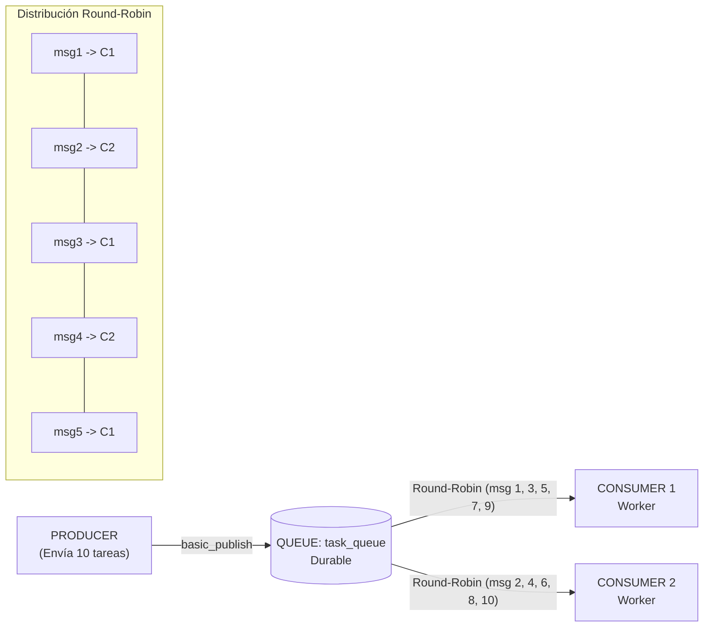
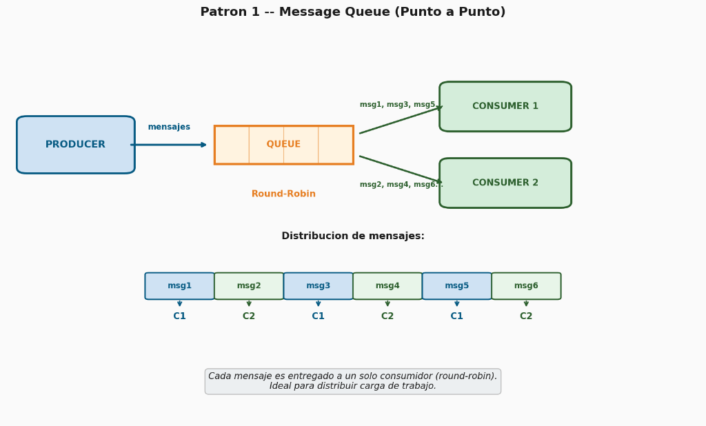

# Hit #0 — Ejemplo 1: Message Queue (Punto a Punto)

Este módulo implementa el patrón **Message Queue (Punto a Punto)** utilizando **RabbitMQ** (protocolo AMQP 0-9-1) y Python (`pika`).

---

## 1. Diagrama de Arquitectura

El patrón Punto a Punto garantiza que **cada mensaje enviado a la cola sea procesado por exactamente un consumidor**, permitiendo balancear la carga de trabajo entre múltiples trabajadores (*workers*):





---

## 2. Decisiones de Diseño

1. **Despacho Equitativo (`channel.basic_qos(prefetch_count=1)`):**
   * Por defecto, RabbitMQ realiza un round-robin ciego enviando ráfagas de mensajes a los buffers de los clientes sin importar si están ocupados.
   * Con `prefetch_count=1`, el broker no entrega un nuevo mensaje a un consumidor hasta que este haya procesado y confirmado (`ACK`) el mensaje anterior. Esto garantiza una distribución de carga verdaderamente equitativa (*Fair Dispatch*).

2. **Garantía de Procesamiento (`auto_ack=False` y `basic_ack` manual):**
   * Si un consumidor cae abruptamente en medio del procesamiento de una tarea, RabbitMQ detecta el cierre del canal TCP y reencola el mensaje automáticamente (`requeue`), asegurando que ninguna tarea se pierda (*At-Least-Once Delivery*).

3. **Persistencia y Durabilidad:**
   * La cola se declara como durable (`durable=True`).
   * Los mensajes se publican con `delivery_mode=2` (persistente en disco), protegiendo la información ante eventuales reinicios del broker.

4. **Resiliencia ante Arranque en Contenedores:**
   * El módulo de conexión implementa reintentos exponenciales con espera activa para evitar fallos por condiciones de carrera si la aplicación arranca antes que el broker en Kubernetes o Docker.

---

## 3. Instrucciones de Ejecución

> **Credenciales:** el usuario y la contraseña de RabbitMQ salen de `TP3/queue/.env`, que no se versiona.
> La primera vez: `cp ../.env.example ../.env` y cambiar la contraseña. En Kubernetes, el mismo archivo se carga
> como Secret antes de aplicar los manifiestos: `kubectl create secret generic rabbitmq-credenciales --from-env-file=../.env`

### Opción A — Ejecución Automatizada Local (Recomendada)
Se incluye un script bash que realiza todo el flujo de demostración automáticamente:
```bash
cd TP3/queue/ex1
./run_local.sh
```

### Opción B — Paso a Paso con Docker Compose

1. **Iniciar RabbitMQ y un único consumidor:**
   ```bash
   docker compose up -d rabbitmq consumer
   ```

2. **Ejecutar el productor (envía 10 tareas):**
   ```bash
   docker compose run --rm producer
   ```

3. **Verificar que el consumidor único procesa las 10 tareas:**
   ```bash
   docker compose logs consumer
   ```

4. **Escalar a 2 consumidores concurrentes:**
   ```bash
   docker compose up -d --scale consumer=2 consumer
   ```

5. **Volver a disparar el productor:**
   ```bash
   docker compose run --rm producer
   ```

6. **Observar la distribución Round-Robin entre ambos consumidores:**
   ```bash
   docker compose logs --tail=30 consumer
   ```

7. **Detener el entorno:**
   ```bash
   docker compose down -v
   ```

---

### Opción C — Despliegue en Kubernetes

Los manifiestos en la carpeta `k8s/` permiten desplegar el ejemplo en cualquier clúster (K3s, Microk8s, Minikube, GKE, EKS):

1. **Construir la imagen e importarla a k3s** (k3s usa containerd, no ve las imágenes locales de Docker):
   ```bash
   docker build -t sdypp/ex1-app:latest .
   docker save sdypp/ex1-app:latest | sudo k3s ctr images import -
   ```

2. **Desplegar RabbitMQ y el Service:**
   ```bash
   kubectl apply -f k8s/01-rabbitmq.yaml
   kubectl wait --for=condition=ready pod -l app=rabbitmq-ex1 --timeout=60s
   ```

3. **Desplegar el consumidor (1 réplica):**
   ```bash
   kubectl apply -f k8s/02-consumer.yaml
   ```

4. **Lanzar el Job del productor:**
   ```bash
   kubectl apply -f k8s/03-producer-job.yaml
   kubectl wait --for=condition=complete job/ex1-producer-job --timeout=60s
   kubectl logs -l app=ex1-consumer
   ```

5. **Escalar a 2 réplicas del consumidor:**
   ```bash
   kubectl scale deployment ex1-consumer --replicas=2
   kubectl delete job ex1-producer-job
   kubectl apply -f k8s/03-producer-job.yaml
   kubectl logs -l app=ex1-consumer -f
   ```

---

## 4. Evidencia Empírica de Ejecución y Comportamiento Observado

### Caso 1: Un Solo Consumidor
Con 1 worker activo, todos los mensajes de la cola son asignados secuencialmente al mismo proceso:
```
consumer-1 | [INFO] 🚀 [CONSUMER:ef89670834b6] Escuchando tareas en cola 'task_queue' (prefetch=1)...
consumer-1 | [INFO] 📥 [CONSUMER:ef89670834b6] Recibida Tarea #1 ('Tarea #1') | Total atendidas: 1
consumer-1 | [INFO] ✅ [CONSUMER:ef89670834b6] Tarea #1 procesada y ACK enviado.
consumer-1 | [INFO] 📥 [CONSUMER:ef89670834b6] Recibida Tarea #2 ('Tarea #2') | Total atendidas: 2
consumer-1 | [INFO] ✅ [CONSUMER:ef89670834b6] Tarea #2 procesada y ACK enviado.
...
consumer-1 | [INFO] 📥 [CONSUMER:ef89670834b6] Recibida Tarea #10 ('Tarea #10') | Total atendidas: 10
consumer-1 | [INFO] ✅ [CONSUMER:ef89670834b6] Tarea #10 procesada y ACK enviado.
```

### Caso 2: Dos Consumidores Concurrentes (Round-Robin)
Al existir 2 consumidores (`consumer-1` y `consumer-2`) compitiendo por la misma cola con `prefetch_count=1`, RabbitMQ distribuye exactamente la mitad del trabajo de forma alternada:

* **`consumer-1` atendió las tareas impares:** #1, #3, #5, #7, #9 (5 tareas)
* **`consumer-2` atendió las tareas pares:** #2, #4, #6, #8, #10 (5 tareas)

**Extracto real de los logs:**
```
consumer-1 | [INFO] 📥 [CONSUMER:ef89670834b6] Recibida Tarea #1 ('Tarea #1')
consumer-2 | [INFO] 📥 [CONSUMER:3d0c518d01a1] Recibida Tarea #2 ('Tarea #2')
consumer-1 | [INFO] 📥 [CONSUMER:ef89670834b6] Recibida Tarea #3 ('Tarea #3')
consumer-2 | [INFO] 📥 [CONSUMER:3d0c518d01a1] Recibida Tarea #4 ('Tarea #4')
consumer-1 | [INFO] 📥 [CONSUMER:ef89670834b6] Recibida Tarea #5 ('Tarea #5')
consumer-2 | [INFO] 📥 [CONSUMER:3d0c518d01a1] Recibida Tarea #6 ('Tarea #6')
consumer-1 | [INFO] 📥 [CONSUMER:ef89670834b6] Recibida Tarea #7 ('Tarea #7')
consumer-2 | [INFO] 📥 [CONSUMER:3d0c518d01a1] Recibida Tarea #8 ('Tarea #8')
consumer-1 | [INFO] 📥 [CONSUMER:ef89670834b6] Recibida Tarea #9 ('Tarea #9')
consumer-2 | [INFO] 📥 [CONSUMER:3d0c518d01a1] Recibida Tarea #10 ('Tarea #10')
```

---

## 5. Pruebas Automatizadas

Para ejecutar la suite de pruebas unitarias:
```bash
pytest tests/
```
Resultado:
```
tests/test_ex1.py ..                                       [100%]
2 passed in 0.09s
```
