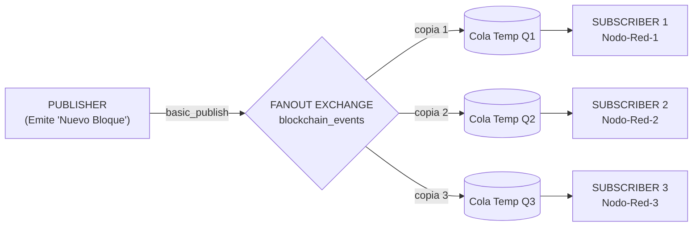
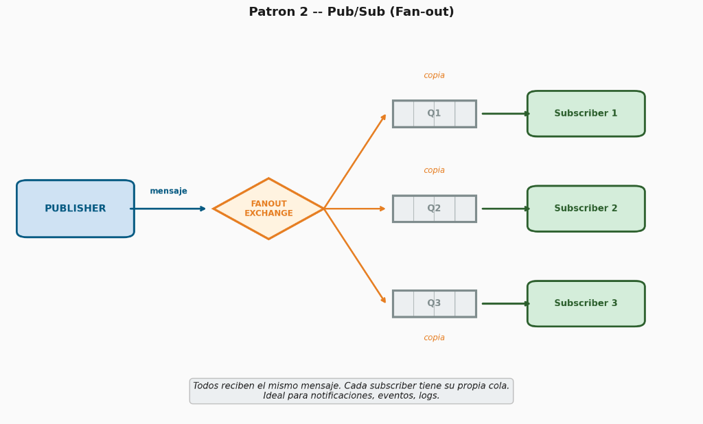

# Hit #0 — Ejemplo 2: Event Bus / Pub-Sub (Fan-out)

Este módulo implementa el patrón **Publicador/Suscriptor (Pub-Sub)** mediante un **Exchange de tipo Fan-out** en **RabbitMQ** (protocolo AMQP 0-9-1) utilizando Python (`pika`).

---

## 1. Diagrama de Arquitectura

En este patrón, el publicador emite mensajes hacia un *Exchange* fanout sin especificar destinatarios ni colas puntuales. El exchange se encarga de **clonar y reenviar una copia de cada mensaje** a cada una de las colas suscriptas:





---

## 2. Fundamentación Teórica y Contexto Industrial

* **Desacoplamiento Espacial y Temporal:** El publicador no sabe cuántos suscriptores existen, qué nombres de colas tienen ni en qué servidores corren. Cualquier nodo puede unirse o abandonar la red en cualquier momento sin afectar al emisor.
* **Equivalentes en la Industria:**
  * **AWS EventBridge / SNS:** Servicios gestionados de publicación y suscripción para arquitecturas dirigidas por eventos (EDA).
  * **Google Cloud Pub/Sub:** Mensajería global con tópicos y subscripciones independientes.
  * **Apache Kafka [KREP11]:** Diseñado con un log distribuido particionado donde cada grupo de consumidores (*Consumer Group*) lee su propia copia del stream de eventos.

---

## 3. Decisiones de Diseño

1. **Exchange de Tipo `fanout`:**
   * Enruta todos los mensajes entrantes a todas las colas vinculadas (`binding`), ignorando el `routing_key`. Es el mecanismo más eficiente en AMQP para *broadcast*.

2. **Colas Efímeras y Exclusivas (`queue='', exclusive=True`):**
   * Cada nodo suscriptor declara una cola sin nombre; RabbitMQ le genera un identificador único aleatorio (ej. `amq.gen-abc123...`).
   * Al ser `exclusive=True`, la cola solo pertenece a esa conexión y se destruye automáticamente cuando el nodo se desconecta o muere, evitando acumular mensajes obsoletos en el broker.

3. **Simulación de Blockchain:**
   * Los eventos representan bloques minados en una red descentralizada con hash criptográfico SHA-256 (`block_hash`), índice, minero de origen y timestamp ISO.

---

## 4. Instrucciones de Ejecución

> **Credenciales:** el usuario y la contraseña de RabbitMQ salen de `TP3/queue/.env`, que no se versiona.
> La primera vez: `cp ../.env.example ../.env` y cambiar la contraseña. En Kubernetes, el mismo archivo se carga
> como Secret antes de aplicar los manifiestos: `kubectl create secret generic rabbitmq-credenciales --from-env-file=../.env`

### Opción A — Ejecución Automatizada Local (Recomendada)
```bash
cd TP3/queue/ex2
./run_local.sh
```

### Opción B — Paso a Paso con Docker Compose

1. **Iniciar RabbitMQ y los 3 nodos suscriptores:**
   ```bash
   docker compose up -d rabbitmq node-1 node-2 node-3
   ```

2. **Disparar el publicador para minar 5 bloques:**
   ```bash
   docker compose run --rm publisher
   ```

3. **Verificar que los 3 nodos recibieron la totalidad de los bloques:**
   ```bash
   docker compose logs node-1 node-2 node-3 | grep "¡NUEVO BLOQUE"
   ```

4. **Detener el entorno:**
   ```bash
   docker compose down -v
   ```

---

### Opción C — Despliegue en Kubernetes

Los manifiestos en la carpeta `k8s/` despliegan el broker, 3 réplicas de nodos suscriptores y el Job emisor:

1. **Construir la imagen e importarla a k3s** (k3s usa containerd, no ve las imágenes locales de Docker):
   ```bash
   docker build -t sdypp/ex2-app:latest .
   docker save sdypp/ex2-app:latest | sudo k3s ctr images import -
   ```

2. **Desplegar RabbitMQ y el Service:**
   ```bash
   kubectl apply -f k8s/01-rabbitmq.yaml
   kubectl wait --for=condition=ready pod -l app=rabbitmq-ex2 --timeout=60s
   ```

3. **Desplegar los 3 nodos suscriptores (`replicas: 3`):**
   ```bash
   kubectl apply -f k8s/02-subscribers.yaml
   kubectl wait --for=condition=ready pod -l app=ex2-subscribers --timeout=60s
   ```

4. **Ejecutar el Job del publicador:**
   ```bash
   kubectl apply -f k8s/03-publisher-job.yaml
   kubectl wait --for=condition=complete job/ex2-publisher-job --timeout=60s
   ```

5. **Inspeccionar los logs de todos los pods de suscripción:**
   ```bash
   kubectl logs -l app=ex2-subscribers --tail=50
   ```

---

## 5. Evidencia Empírica de Ejecución y Comportamiento Observado

### Registro de Publicación:
```
[INFO] ==> Iniciando publicación de 5 eventos de 'Nuevo Bloque Minado' en exchange FANOUT 'blockchain_events'...
[INFO] ⛏️ [PUBLISHER] Emitido evento: Bloque #1 minado | Hash: 0b21d035f9193b90... | Minero: Miner-Node-Alpha
[INFO] ⛏️ [PUBLISHER] Emitido evento: Bloque #2 minado | Hash: d024f7b96f7f26ea... | Minero: Miner-Node-Alpha
[INFO] ⛏️ [PUBLISHER] Emitido evento: Bloque #3 minado | Hash: a110e492aa7620d6... | Minero: Miner-Node-Alpha
[INFO] ⛏️ [PUBLISHER] Emitido evento: Bloque #4 minado | Hash: 02e0cbb04f18d373... | Minero: Miner-Node-Alpha
[INFO] ⛏️ [PUBLISHER] Emitido evento: Bloque #5 minado | Hash: c3f7342146cd718f... | Minero: Miner-Node-Alpha
```

### Recepción Simultánea en los 3 Nodos de la Red:
Cada nodo recibió su propia copia de los 5 bloques, verificando el comportamiento del exchange fanout:

```
node-1-1 | [INFO] 📦 [NODE:Nodo-Red-1] ¡NUEVO BLOQUE MINADO RECIBIDO! Bloque #1 | Hash: 0b21d035f9193b90... | Total: 1
node-1-1 | [INFO] 📦 [NODE:Nodo-Red-1] ¡NUEVO BLOQUE MINADO RECIBIDO! Bloque #2 | Hash: d024f7b96f7f26ea... | Total: 2
node-1-1 | [INFO] 📦 [NODE:Nodo-Red-1] ¡NUEVO BLOQUE MINADO RECIBIDO! Bloque #3 | Hash: a110e492aa7620d6... | Total: 3
node-1-1 | [INFO] 📦 [NODE:Nodo-Red-1] ¡NUEVO BLOQUE MINADO RECIBIDO! Bloque #4 | Hash: 02e0cbb04f18d373... | Total: 4
node-1-1 | [INFO] 📦 [NODE:Nodo-Red-1] ¡NUEVO BLOQUE MINADO RECIBIDO! Bloque #5 | Hash: c3f7342146cd718f... | Total: 5

node-2-1 | [INFO] 📦 [NODE:Nodo-Red-2] ¡NUEVO BLOQUE MINADO RECIBIDO! Bloque #1 | Hash: 0b21d035f9193b90... | Total: 1
node-2-1 | [INFO] 📦 [NODE:Nodo-Red-2] ¡NUEVO BLOQUE MINADO RECIBIDO! Bloque #2 | Hash: d024f7b96f7f26ea... | Total: 2
node-2-1 | [INFO] 📦 [NODE:Nodo-Red-2] ¡NUEVO BLOQUE MINADO RECIBIDO! Bloque #3 | Hash: a110e492aa7620d6... | Total: 3
node-2-1 | [INFO] 📦 [NODE:Nodo-Red-2] ¡NUEVO BLOQUE MINADO RECIBIDO! Bloque #4 | Hash: 02e0cbb04f18d373... | Total: 4
node-2-1 | [INFO] 📦 [NODE:Nodo-Red-2] ¡NUEVO BLOQUE MINADO RECIBIDO! Bloque #5 | Hash: c3f7342146cd718f... | Total: 5

node-3-1 | [INFO] 📦 [NODE:Nodo-Red-3] ¡NUEVO BLOQUE MINADO RECIBIDO! Bloque #1 | Hash: 0b21d035f9193b90... | Total: 1
node-3-1 | [INFO] 📦 [NODE:Nodo-Red-3] ¡NUEVO BLOQUE MINADO RECIBIDO! Bloque #2 | Hash: d024f7b96f7f26ea... | Total: 2
node-3-1 | [INFO] 📦 [NODE:Nodo-Red-3] ¡NUEVO BLOQUE MINADO RECIBIDO! Bloque #3 | Hash: a110e492aa7620d6... | Total: 3
node-3-1 | [INFO] 📦 [NODE:Nodo-Red-3] ¡NUEVO BLOQUE MINADO RECIBIDO! Bloque #4 | Hash: 02e0cbb04f18d373... | Total: 4
node-3-1 | [INFO] 📦 [NODE:Nodo-Red-3] ¡NUEVO BLOQUE MINADO RECIBIDO! Bloque #5 | Hash: c3f7342146cd718f... | Total: 5
```

---

## 6. Pruebas Automatizadas

```bash
pytest tests/
```
Resultado:
```
tests/test_ex2.py ..                                       [100%]
2 passed in 0.03s
```
