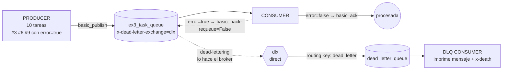
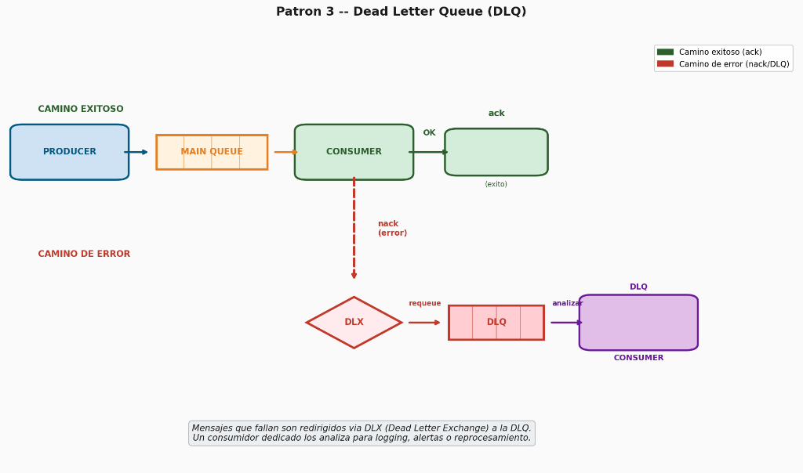

# Hit #0 — Ejemplo 3: Dead Letter Queue (DLQ)

Este módulo implementa el patrón **Dead Letter Queue** utilizando un **Dead Letter Exchange (DLX)** de **RabbitMQ** (protocolo AMQP 0-9-1) y Python (`pika`).

---

## 1. Diagrama de Arquitectura

El consumidor rechaza (`nack`) los mensajes que traen `"error": true`. No los reenvía él: **RabbitMQ los re-publica automáticamente** en el DLX porque la cola principal está declarada con `x-dead-letter-exchange`. Un segundo consumidor lee la DLQ y los imprime.





---

## 2. Decisiones de Diseño

1. **El desvío lo hace el broker, no el código (`x-dead-letter-exchange`):**
   * La cola principal se declara con los argumentos `x-dead-letter-exchange=dlx` y `x-dead-letter-routing-key=dead_letter`.
   * El consumidor solo hace `basic_nack(requeue=False)`. RabbitMQ toma el mensaje rechazado y lo publica en `dlx`, que lo enruta a `dead_letter_queue`.
   * Así, ningún consumidor necesita conocer la DLQ. Si el consumidor se cae a mitad de camino, el mensaje no se pierde: o sigue en la cola principal o ya está en la DLQ.

2. **`requeue=False` es obligatorio:**
   * Con `requeue=True` (como el ej. 1 ante una excepción) el mensaje vuelve a la **misma** cola y se reintenta indefinidamente: nunca llega a la DLQ y bloquea al consumidor con un *poison message*.

3. **Mensajes corruptos también van a la DLQ:**
   * Un body que no es JSON nunca va a poder procesarse, así que se trata igual que `error: true`. La condición del enunciado se evalúa estricta (`payload.get("error") is True`): `"error": "true"` como string no cuenta como error.

4. **Topología compartida (`src/topology.py`):**
   * Producer, consumer y dlq_consumer declaran la topología completa al arrancar. Las declaraciones son idempotentes, así que no importa el orden de arranque de los pods.
   * Los argumentos tienen que ser **idénticos** en todos los procesos: si una cola ya existe con otros `arguments`, RabbitMQ cierra el canal con `PRECONDITION_FAILED`. Por eso están definidos en un solo lugar.

5. **Evidencia del broker (header `x-death`):**
   * Al dead-letterear, RabbitMQ agrega el header `x-death` con el motivo (`rejected`, `expired`, `maxlen`), la cola de origen y la cantidad de veces. El consumidor de la DLQ lo imprime para demostrar que el mensaje llegó por el mecanismo del broker.

6. **Durabilidad:** exchange y colas `durable=True`, mensajes con `delivery_mode=2`. Los mensajes dead-letter conservan sus propiedades, por lo que también siguen siendo persistentes en la DLQ.

---

## 3. Instrucciones de Ejecución

> **Credenciales:** el usuario y la contraseña de RabbitMQ salen de `TP3/queue/.env`, que no se versiona.
> La primera vez: `cp ../.env.example ../.env` y cambiar la contraseña. En Kubernetes, el mismo archivo se carga
> como Secret antes de aplicar los manifiestos: `kubectl create secret generic rabbitmq-credenciales --from-env-file=../.env`

### Opción A — Ejecución Automatizada Local (Recomendada)
```bash
cd TP3/queue/ex3
./run_local.sh
```

### Opción B — Paso a Paso con Docker Compose

1. **Construir la imagen e iniciar RabbitMQ + ambos consumidores:**
   ```bash
   docker compose build consumer
   docker compose up -d --wait rabbitmq
   docker compose up -d consumer dlq-consumer
   ```

2. **Ejecutar el productor (10 tareas, las #3, #6 y #9 con `error: true`):**
   ```bash
   docker compose run --rm producer
   ```

3. **Ver los logs:**
   ```bash
   docker compose logs consumer       # ACK de las válidas, nack de #3 #6 #9
   docker compose logs dlq-consumer   # solo recibe #3 #6 #9
   ```

4. **Ver la topología en el broker** (o en la UI http://localhost:15672, con el usuario de `TP3/queue/.env`):
   ```bash
   docker compose exec rabbitmq rabbitmqctl list_queues name arguments messages
   ```

5. **Detener el entorno:**
   ```bash
   docker compose down -v
   ```

Variables configurables del productor: `NUM_TASKS` (default 10), `ERROR_EVERY` (default 3; `0` desactiva los errores) y `DELAY_BETWEEN_TASKS`.

---

### Opción C — Despliegue en Kubernetes (k3s)

1. **Construir la imagen e importarla a k3s** (k3s usa containerd, no ve las imágenes de Docker):
   ```bash
   docker build -t sdypp/ex3-app:latest .
   docker save sdypp/ex3-app:latest | sudo k3s ctr images import -
   ```

2. **Desplegar RabbitMQ:**
   ```bash
   kubectl apply -f k8s/01-rabbitmq.yaml
   kubectl wait --for=condition=ready pod -l app=rabbitmq-ex3 --timeout=90s
   ```

3. **Desplegar ambos consumidores:**
   ```bash
   kubectl apply -f k8s/02-consumer.yaml -f k8s/03-dlq-consumer.yaml
   ```

4. **Lanzar el Job del productor:**
   ```bash
   kubectl apply -f k8s/04-producer-job.yaml
   kubectl wait --for=condition=complete job/ex3-producer-job --timeout=60s
   kubectl logs -l app=ex3-consumer
   kubectl logs -l app=ex3-dlq-consumer
   ```

5. **UI de management:**
   ```bash
   kubectl port-forward svc/rabbitmq-ex3-service 15672:15672
   ```

6. **Limpiar:**
   ```bash
   kubectl delete -f k8s/
   ```

---

## 4. Evidencia Empírica de Ejecución y Comportamiento Observado

### Consumidor principal
Las tareas válidas reciben `ACK`; las que tienen `error: true` se rechazan sin reencolar:
```
✅ [CONSUMER:b693a3f32459] Tarea #1 procesada y ACK enviado.
✅ [CONSUMER:b693a3f32459] Tarea #2 procesada y ACK enviado.
⛔ [CONSUMER:b693a3f32459] Tarea #3 con error=true → nack(requeue=False)
✅ [CONSUMER:b693a3f32459] Tarea #4 procesada y ACK enviado.
✅ [CONSUMER:b693a3f32459] Tarea #5 procesada y ACK enviado.
⛔ [CONSUMER:b693a3f32459] Tarea #6 con error=true → nack(requeue=False)
✅ [CONSUMER:b693a3f32459] Tarea #7 procesada y ACK enviado.
✅ [CONSUMER:b693a3f32459] Tarea #8 procesada y ACK enviado.
⛔ [CONSUMER:b693a3f32459] Tarea #9 con error=true → nack(requeue=False)
✅ [CONSUMER:b693a3f32459] Tarea #10 procesada y ACK enviado.
```

### Consumidor de la DLQ
Recibe **exactamente** las 3 tareas rechazadas, cada una con el header `x-death` que agregó RabbitMQ (`reason=rejected`, cola de origen `ex3_task_queue`):
```
🪦 [DLQ:0ccde9e850f5] Mensaje fallido #1: {"task_id": 3, "title": "Tarea #3", "error": true, ...} | reason=rejected queue=ex3_task_queue count=1
🪦 [DLQ:0ccde9e850f5] Mensaje fallido #2: {"task_id": 6, "title": "Tarea #6", "error": true, ...} | reason=rejected queue=ex3_task_queue count=1
🪦 [DLQ:0ccde9e850f5] Mensaje fallido #3: {"task_id": 9, "title": "Tarea #9", "error": true, ...} | reason=rejected queue=ex3_task_queue count=1
```

### Topología en el broker
```
$ rabbitmqctl list_queues name arguments messages
ex3_task_queue      [{"x-dead-letter-exchange","dlx"},{"x-dead-letter-routing-key","dead_letter"}]  0
dead_letter_queue   []                                                                               0

$ rabbitmqctl list_bindings source_name destination_name routing_key
dlx                 dead_letter_queue                                                                dead_letter
```
Ambas colas quedan en 0 mensajes: las válidas se confirmaron y las fallidas fueron consumidas desde la DLQ.

---

## 5. Pruebas Automatizadas

```bash
pytest tests/
```
Cubren la declaración de la topología (argumentos DLX de la cola principal y binding de la DLQ), el marcado de errores del productor, el `ack`/`nack(requeue=False)` del consumidor (incluyendo payload corrupto y `"error": "true"` como string) y la lectura del header `x-death`.
```
tests/test_ex3.py ..........                               [100%]
10 passed
```
