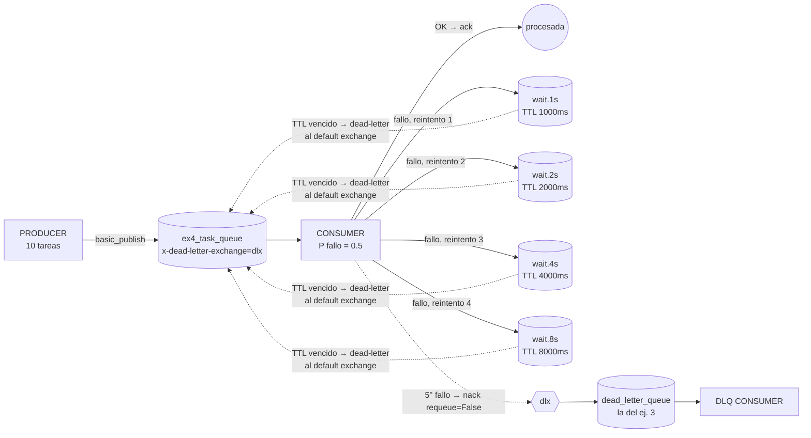
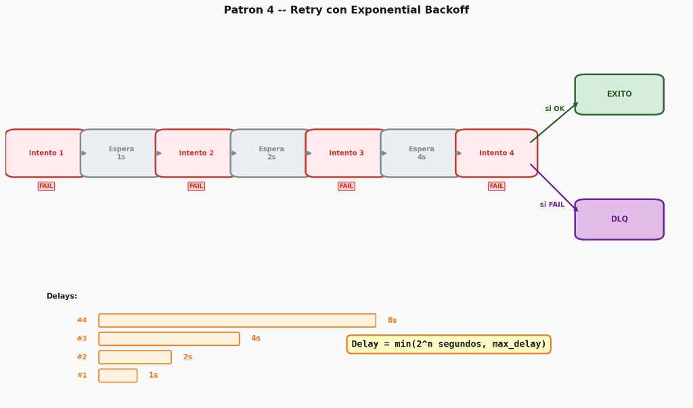

# Hit #0 — Ejemplo 4: Retry con Exponential Backoff

Este módulo implementa el patrón **Retry con Exponential Backoff** sobre **RabbitMQ** (protocolo AMQP 0-9-1) y Python (`pika`), usando **TTL de cola + colas de espera** para el delay y la **DLQ del ejemplo 3** como destino final.

---

## 1. Diagrama de Arquitectura

El consumidor intenta procesar cada mensaje y falla al azar con probabilidad 50%. Ante un fallo, re-publica el mensaje en una **cola de espera** que corresponde al número de reintento (1s, 2s, 4s, 8s). Esas colas no tienen consumidores: cuando vence el TTL, RabbitMQ devuelve el mensaje a la cola principal. Después de 4 reintentos fallidos, el mensaje va a la DLQ.





Secuencia de un mensaje que falla siempre:

| Intento | Resultado | Espera antes del siguiente | Cola de espera |
|---|---|---|---|
| 1 (original) | falla | 1s | `ex4_task_queue.wait.1s` |
| 2 (reintento 1) | falla | 2s | `ex4_task_queue.wait.2s` |
| 3 (reintento 2) | falla | 4s | `ex4_task_queue.wait.4s` |
| 4 (reintento 3) | falla | 8s | `ex4_task_queue.wait.8s` |
| 5 (reintento 4) | falla | — | `dead_letter_queue` |

"Después de 4 reintentos fallidos" se interpreta como **1 intento original + 4 reintentos = 5 intentos**. Así se usan las cuatro esperas del enunciado (1s, 2s, 4s y 8s).

---

## 2. Decisiones de Diseño

1. **TTL + colas de espera en lugar del plugin `rabbitmq_delayed_message_exchange`:**
   * El plugin no viene en la imagen oficial de RabbitMQ: habría que construir y mantener una imagen propia con el `.ez`. Con TTL se usa solo funcionalidad estándar del broker.
   * Además, el delay vive en el broker y no en el consumidor: el consumidor nunca hace `sleep`, queda libre para procesar otros mensajes mientras uno espera, y si se cae durante la espera el mensaje no se pierde.

2. **Una cola de espera por nivel (TTL de cola) y no una sola cola con TTL por mensaje:**
   * RabbitMQ solo expira los mensajes que están **a la cabeza** de la cola. Con una única cola de espera y TTL por mensaje (`expiration`), un mensaje de 8s adelante bloquea a uno de 1s que llegó después: este último esperaría 8s.
   * Con una cola por nivel, todos los mensajes de una misma cola tienen el mismo TTL, así que el orden de llegada coincide con el orden de vencimiento y no hay bloqueo de cabeza de cola.

3. **Retorno a la cola principal vía dead-lettering:**
   * Cada cola de espera tiene `x-dead-letter-exchange=""` (default exchange) y `x-dead-letter-routing-key=ex4_task_queue`. Al vencer el TTL, el broker re-publica el mensaje en la cola principal.

4. **Contador de reintentos propio (`x-retry-count`):**
   * El consumidor lleva la cuenta en un header propio en lugar de depender de `x-death`, que administra el broker y cuyo comportamiento cambió entre versiones. Al re-publicar se descartan los headers `x-death*`.
   * También se agregan `x-retry-delay` y `x-retry-scheduled-at-ms` (entero: AMQP no admite floats en los headers). Con ellos, en el siguiente intento se loguea **cuánto esperó realmente** el mensaje.

5. **Primero publicar el reintento, después hacer `ack` (con publisher confirms):**
   * El canal está en modo confirm (`confirm_delivery()`) y el reintento se publica con `mandatory=True`: `basic_publish` no retorna hasta que el broker lo aceptó, y lanza excepción si no lo puede enrutar. Recién ahí se hace `ack` del original.
   * Si el proceso muere entre ambos pasos, el mensaje queda duplicado (*at-least-once*) pero nunca se pierde. Si el broker rechaza el reintento, el original se reencola con `nack(requeue=True)`.

6. **Agotados los reintentos, a la DLQ del ejemplo 3:**
   * La cola principal tiene `x-dead-letter-exchange=dlx`, igual que en el ej. 3. En el último fallo el consumidor hace `nack(requeue=False)` y el broker lo deriva a `dead_letter_queue`.
   * El DLX y la DLQ se declaran con los **mismos nombres y argumentos** que en el ej. 3. Cada ejemplo levanta su propio RabbitMQ (igual que ex1 y ex2), pero si se apuntaran al mismo broker compartirían la misma DLQ.

7. **Mensajes corruptos sin reintentos:** un body que no es JSON va directo a la DLQ, porque reintentarlo no lo va a arreglar.

8. **`force_fail` para la demo:** con P(fallo)=0.5, un mensaje llega a la DLQ solo con probabilidad 0.5⁵ ≈ 3%. Para que la demo siempre muestre ese camino, el productor marca 1 de cada 5 tareas (`FORCE_FAIL_EVERY`) con `"force_fail": true`. El resto falla al azar. Con `FORCE_FAIL_EVERY=0` todas fallan solo al azar.

---

## 3. Instrucciones de Ejecución

> **Credenciales:** el usuario y la contraseña de RabbitMQ salen de `TP3/queue/.env`, que no se versiona.
> La primera vez: `cp ../.env.example ../.env` y cambiar la contraseña. En Kubernetes, el mismo archivo se carga
> como Secret antes de aplicar los manifiestos: `kubectl create secret generic rabbitmq-credenciales --from-env-file=../.env`

### Opción A — Ejecución Automatizada Local (Recomendada)
```bash
cd TP3/queue/ex4
./run_local.sh
```

### Opción B — Paso a Paso con Docker Compose

1. **Construir la imagen e iniciar RabbitMQ + ambos consumidores:**
   ```bash
   docker compose build consumer
   docker compose up -d --wait rabbitmq
   docker compose up -d consumer dlq-consumer
   ```

2. **Ejecutar el productor:**
   ```bash
   docker compose run --rm producer
   ```

3. **Seguir los intentos en vivo** (en el peor caso tardan 1+2+4+8 = 15s más el procesamiento):
   ```bash
   docker compose logs -f consumer
   docker compose logs dlq-consumer
   ```

4. **Ver las colas de espera** (o en la UI http://localhost:15672, con el usuario de `TP3/queue/.env`; durante la corrida se ven los mensajes pasar por las colas `wait.*`):
   ```bash
   docker compose exec rabbitmq rabbitmqctl list_queues name arguments messages
   ```

5. **Detener el entorno:**
   ```bash
   docker compose down -v
   ```

Variables configurables:

| Variable | Proceso | Default | Descripción |
|---|---|---|---|
| `FAIL_PROBABILITY` | consumer | `0.5` | Probabilidad de fallo de cada intento |
| `MAX_RETRIES` | consumer | `4` | Reintentos antes de mandar a la DLQ |
| `BASE_DELAY_SECONDS` | consumer | `1` | Espera del primer reintento; se duplica en cada uno |
| `RANDOM_SEED` | consumer | — | Semilla para reproducir una corrida |
| `LOG_FILE` | consumer | — | Si se define, el registro de intentos también se escribe en ese archivo |
| `NUM_TASKS` | producer | `10` | Tareas a enviar |
| `FORCE_FAIL_EVERY` | producer | `5` | 1 de cada N tareas falla siempre (`0` desactiva) |

`MAX_RETRIES` y `BASE_DELAY_SECONDS` definen la topología (las colas `wait.*`). Si se cambian, el productor y los consumidores tienen que usar los mismos valores, y hay que borrar las colas existentes (`docker compose down -v`), porque RabbitMQ no permite redeclarar una cola con otros argumentos.

---

### Opción C — Despliegue en Kubernetes (k3s)

1. **Construir la imagen e importarla a k3s** (k3s usa containerd, no ve las imágenes de Docker):
   ```bash
   docker build -t sdypp/ex4-app:latest .
   docker save sdypp/ex4-app:latest | sudo k3s ctr images import -
   ```

2. **Desplegar RabbitMQ:**
   ```bash
   kubectl apply -f k8s/01-rabbitmq.yaml
   kubectl wait --for=condition=ready pod -l app=rabbitmq-ex4 --timeout=90s
   ```

3. **Desplegar ambos consumidores:**
   ```bash
   kubectl apply -f k8s/02-consumer.yaml -f k8s/03-dlq-consumer.yaml
   ```

4. **Lanzar el Job del productor y seguir los intentos:**
   ```bash
   kubectl apply -f k8s/04-producer-job.yaml
   kubectl logs -l app=ex4-consumer -f
   kubectl logs -l app=ex4-dlq-consumer
   ```

5. **Escalar el consumidor** (los reintentos los toma cualquier réplica, porque el estado viaja en los headers del mensaje):
   ```bash
   kubectl scale deployment ex4-consumer --replicas=2
   ```

6. **UI de management y limpieza:**
   ```bash
   kubectl port-forward svc/rabbitmq-ex4-service 15672:15672
   kubectl delete -f k8s/
   ```

---

## 4. Evidencia Empírica de Ejecución y Comportamiento Observado

### Ciclo de vida de una tarea que agota los reintentos
La tarea #5 (`force_fail`) muestra el backoff exponencial completo, con el tiempo de espera real medido en cada intento:
```
📥 Tarea #5 intento 1/5
🔁 Tarea #5 falló en el intento 1 (fallo forzado por el productor). Reintento 1/4 en 1s → 'ex4_task_queue.wait.1s'
📥 Tarea #5 intento 2/5 | esperó 1.41s (backoff 1s)
🔁 Tarea #5 falló en el intento 2 (fallo forzado por el productor). Reintento 2/4 en 2s → 'ex4_task_queue.wait.2s'
📥 Tarea #5 intento 3/5 | esperó 2.00s (backoff 2s)
🔁 Tarea #5 falló en el intento 3 (fallo forzado por el productor). Reintento 3/4 en 4s → 'ex4_task_queue.wait.4s'
📥 Tarea #5 intento 4/5 | esperó 4.00s (backoff 4s)
🔁 Tarea #5 falló en el intento 4 (fallo forzado por el productor). Reintento 4/4 en 8s → 'ex4_task_queue.wait.8s'
📥 Tarea #5 intento 5/5 | esperó 8.00s (backoff 8s)
🪦 Tarea #5 falló en el intento 5 (fallo forzado por el productor). Agotó 4 reintentos → DLQ
```

### Tareas con fallos aleatorios que se recuperan
```
📥 Tarea #2 intento 1/5
🔁 Tarea #2 falló en el intento 1 (fallo transitorio simulado). Reintento 1/4 en 1s → 'ex4_task_queue.wait.1s'
📥 Tarea #2 intento 2/5 | esperó 1.62s (backoff 1s)
✅ Tarea #2 OK en el intento 2/5
📥 Tarea #9 intento 1/5
🔁 Tarea #9 falló en el intento 1 (fallo transitorio simulado). Reintento 1/4 en 1s → 'ex4_task_queue.wait.1s'
📥 Tarea #9 intento 2/5 | esperó 1.00s (backoff 1s)
✅ Tarea #9 OK en el intento 2/5
```
En esta corrida, de las 8 tareas con fallo aleatorio 5 salieron bien al primer intento y 3 en el segundo. Las 2 con `force_fail` (#5 y #10) terminaron en la DLQ.

**Observación:** el TTL garantiza una espera **mínima**, no exacta. Las primeras esperas de 1s midieron 1.41s y 1.62s porque cuando el mensaje volvió a la cola principal todavía había tareas originales adelante, y el único consumidor (prefetch=1, 0.2s por tarea) las procesó primero. Con la cola vacía, las esperas medidas coinciden con el backoff (1.00s, 2.00s, 4.00s, 8.00s).

### Consumidor de la DLQ
```
🪦 [DLQ:a15930da5f5a] Mensaje fallido #1: {"task_id": 5, "title": "Tarea #5", "force_fail": true, ...} | reason=rejected queue=ex4_task_queue count=1 | reintentos=4
🪦 [DLQ:a15930da5f5a] Mensaje fallido #2: {"task_id": 10, "title": "Tarea #10", "force_fail": true, ...} | reason=rejected queue=ex4_task_queue count=1 | reintentos=4
```

### Topología en el broker
```
$ rabbitmqctl list_queues name arguments messages
ex4_task_queue          [{"x-dead-letter-exchange","dlx"},{"x-dead-letter-routing-key","dead_letter"}]                               0
dead_letter_queue       []                                                                                                           0
ex4_task_queue.wait.1s  [{"x-message-ttl",1000},{"x-dead-letter-exchange",[]},{"x-dead-letter-routing-key","ex4_task_queue"}]       0
ex4_task_queue.wait.2s  [{"x-message-ttl",2000},{"x-dead-letter-exchange",[]},{"x-dead-letter-routing-key","ex4_task_queue"}]       0
ex4_task_queue.wait.4s  [{"x-message-ttl",4000},{"x-dead-letter-exchange",[]},{"x-dead-letter-routing-key","ex4_task_queue"}]       0
ex4_task_queue.wait.8s  [{"x-message-ttl",8000},{"x-dead-letter-exchange",[]},{"x-dead-letter-routing-key","ex4_task_queue"}]       0
```

---

## 5. Pruebas Automatizadas

```bash
pytest tests/
```
Cubren el cálculo del backoff (`[1, 2, 4, 8]`), la decisión reintentar/DLQ en cada intento, la declaración de las colas de espera con su TTL, el orden publicar-reintento → `ack`, el envío a la DLQ al agotar los reintentos, el reencolado si el broker rechaza el reintento, mensajes corruptos, que los headers se puedan serializar en AMQP y que la tasa de fallo simulada sea ≈ 50%.
```
tests/test_ex4.py ................                         [100%]
16 passed
```
