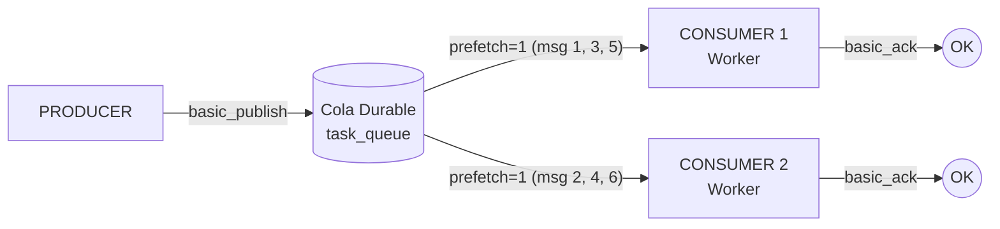
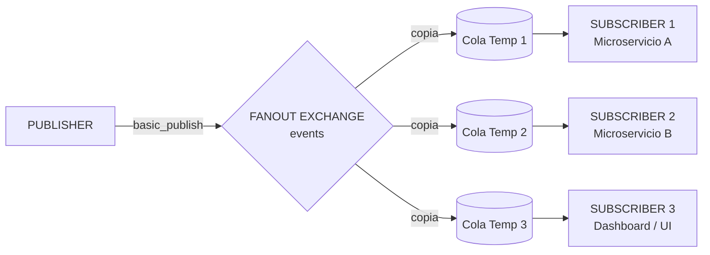
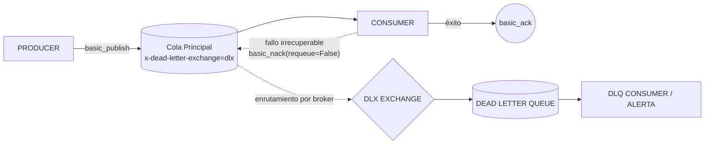
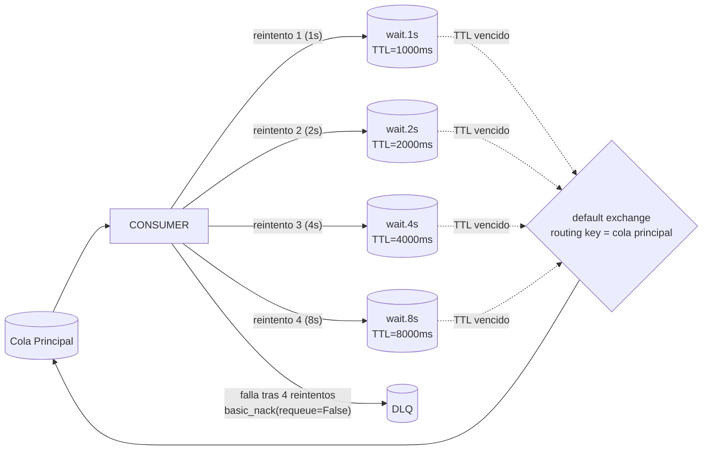
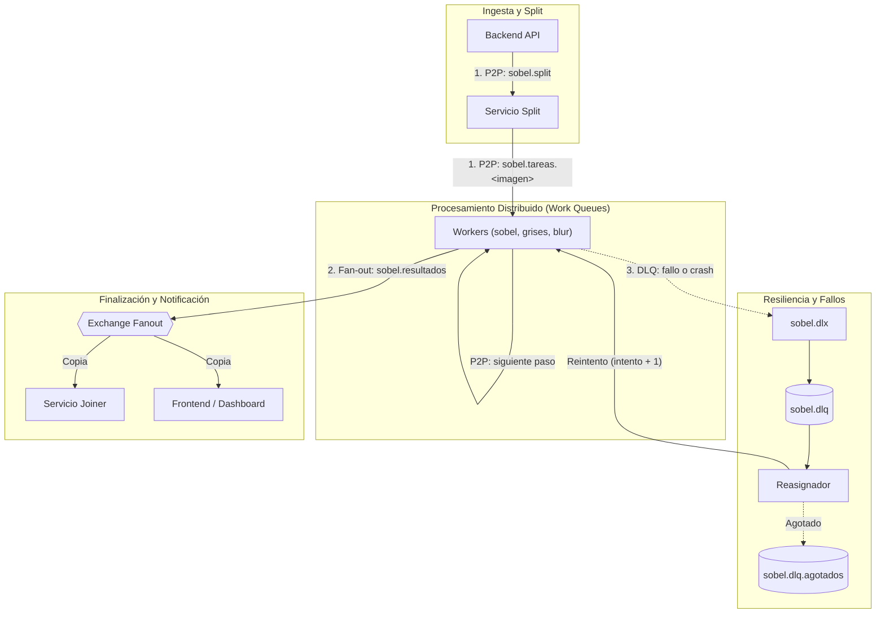

# Hit #0 — Ejemplo 5: Comparativa y Síntesis de Patrones de Mensajería

Este documento presenta una síntesis analítica y comparativa de los cuatro patrones de mensajería implementados en los ejemplos del Hit #0 utilizando **RabbitMQ** (protocolo AMQP 0-9-1) y Python (`pika`), junto con sus criterios de selección y su aplicación directa en la arquitectura distribuida del **Hit #3 (Sobel Asincrónico)**.

---

## 1. Catálogo y Diagramas de Arquitectura

### 1.1 Patrón 1: Message Queue (Punto a Punto / Competing Consumers)
* **Objetivo:** Distribuir una carga de trabajo homogénea entre múltiples trabajadores independientes de forma balanceada y sin duplicidad.
* **Mecánica:** Los mensajes se encolan en una única estructura persistente (`durable=True`). Múltiples consumidores compiten por los mensajes; el broker entrega cada mensaje a **un único consumidor** utilizando un despacho equitativo regulado por `basic_qos(prefetch_count=1)`. El procesamiento se confirma explícitamente con `basic_ack`.

---

### 1.2 Patrón 2: Event Bus / Pub-Sub (Fan-out Exchange)
* **Objetivo:** Notificar la ocurrencia de eventos a múltiples subsistemas interesados en forma simultánea, sin que el emisor conozca la cantidad ni identidad de los destinatarios.
* **Mecánica:** El emisor publica en un **Exchange de tipo `fanout`**. Cada consumidor declara su propia cola efímera y exclusiva (`exclusive=True`). El broker clona y entrega una copia exacta de cada mensaje a todas las colas vinculadas (*broadcast*).

---

### 1.3 Patrón 3: Dead Letter Queue (DLQ / Cola de Mensajes Muertos)
* **Objetivo:** Aislar mensajes que causan errores no recuperables (*poison messages*) para evitar el bloqueo del pipeline o la degradación del consumidor.
* **Mecánica:** La cola de trabajo se configura con el argumento `x-dead-letter-exchange`. Cuando un consumidor detecta una condición fatal o mensaje corrupto, emite `basic_nack(requeue=False)`. En lugar de descartarse o reencolarse infinitamente, el broker reenvía el mensaje al exchange de desvío (DLX), depositándolo en una cola de mensajes muertos (`DLQ`) con metadatos de auditoría en las cabeceras (`x-death`).

---

### 1.4 Patrón 4: Retry con Exponential Backoff (Retardo Exponencial sin Bloqueo)
* **Objetivo:** Reintentar el procesamiento de mensajes ante fallos transitorios (ej. saturación temporal de base de datos o timeout de red), espaciando los reintentos exponencialmente ($t = 2^k \cdot t_0$) sin congelar el hilo del consumidor (`sleep`).
* **Mecánica:** Se utilizan colas intermedias de espera (una por nivel: 1, 2, 4 y 8 s) configuradas con `x-message-ttl` y un dead-letter al exchange por defecto con la cola principal como routing key, que devuelve el mensaje a la cola de procesamiento. El consumidor incrementa un contador en las cabeceras (`x-retry-count`) y publica el mensaje en la cola con el delay correspondiente; al vencer el TTL, RabbitMQ lo devuelve a la cola principal. Si falla después de `MAX_RETRIES` (4) reintentos, hace `basic_nack(requeue=False)` y la cola principal lo deriva a la DLQ.

---

## 2. Matriz Comparativa de Diferencias

| Dimensión | 1. Message Queue (P2P) | 2. Pub-Sub (Fan-out) | 3. Dead Letter Queue (DLQ) | 4. Retry con Backoff |
|---|---|---|---|---|
| **Topología AMQP** | Default exchange o Direct -> Cola compartida | Fanout Exchange -> N Colas vinculadas | Cola principal con `x-dead-letter-*` -> DLX -> DLQ | Colas de espera con `x-message-ttl` y DLX en bucle |
| **Cardinalidad de Entrega** | 1 a 1 (un mensaje, un receptor) | 1 a N (un mensaje, todos los suscriptores) | 1 a 1 (desvío de mensajes anómalos) | 1 a 1 (reingreso diferido al mismo pipeline) |
| **Garantía Semántica** | *At-Least-Once* (con ACK manual) | *At-Least-Once* por cola activa | Preservación de fallas (no pérdida de datos) | Eventual consistencia o derivación a DLQ |
| **Desacoplamiento** | Temporal y espacial; consumidores compiten | Espacial total; emisor desconoce suscriptores | Operacional: desacopla fallo de procesamiento | Temporal elástico: amortigua sobrecargas |
| **Ciclo de Vida de Colas** | Durable y estática | Efímera / temporal (`exclusive=True`) | Durable y persistente (para auditoría) | Colas de delay estáticas o configurables |
| **Manejo de Errores** | Reencolado inmediato (`requeue=True`) | Local por cada suscriptor | Aislamiento y trazabilidad (`x-death`) | Reintento progresivo espaciado en el tiempo |

---

## 3. Criterios de Selección: ¿Cuándo usar cada patrón?

### Cuándo usar Message Queue (Punto a Punto / Competing Consumers):
- **Procesamiento de tareas pesadas o asíncronas:** renderizado de imágenes, transcodificación de video, generación de PDFs.
- **Escalabilidad horizontal dinámica:** agregar o quitar réplicas de workers según la longitud de la cola.
- **Evitar:** cuando múltiples subsistemas no relacionados necesitan reaccionar ante el mismo evento de negocio.

### Cuándo usar Pub-Sub (Fan-out):
- **Propagación de eventos de dominio:** un pedido fue pagado, un nuevo usuario se registró, o un nuevo bloque fue minado.
- **Alimentación simultánea de lectura y dashboards:** notificar a la base de datos de auditoría, al motor de analítica y a la UI por WebSockets al mismo tiempo.
- **Evitar:** cuando se necesita balancear carga entre procesos idénticos (usaríais P2P).

### Cuándo usar Dead Letter Queue (DLQ):
- **Protección contra mensajes venenosos (*poison pills*):** payloads corruptos o con formato JSON inválido que provocarían crashes eternos en los consumidores.
- **Inspección forense y alertas:** permitir que un equipo de soporte analice por qué falló un mensaje sin detener el procesamiento del resto.
- **Evitar:** ante fallos transitorios de red que se resolverían esperando unos segundos (para eso usar Retry Backoff).

### Cuándo usar Retry con Exponential Backoff:
- **Dependencias externas intermitentes:** llamadas a APIs de terceros con rate limiting, conexión transitoria con Redis o base de datos.
- **Prevención de colapso (*thundering herd*):** si un servicio se recupera de una caída, el backoff evita que todos los workers reintenten al mismo milisegundo.
- **Evitar:** errores lógicos deterministas (ej. `400 Bad Request` por parámetro faltante jamás se resolverá reintentando).

---

## 4. Síntesis y Aplicación Integrada en el Hit #3 (Sobel Asincrónico)

En el sistema distribuido completo del TP (**Hit #3**), ninguno de estos patrones funciona de manera aislada; se combinan formando una arquitectura robusta:

1. **Patrón 1 (P2P / Work Queue):** Utilizado en `sobel.split` y `sobel.tareas.<imagen>` (una cola por imagen de worker) para repartir equitativamente los fragmentos de imágenes entre los pods de workers activos en Kubernetes.
2. **Patrón 2 (Pub-Sub / Fan-out):** Utilizado en el exchange `sobel.resultados`. Cuando un worker finaliza el último paso de un fragmento, emite al fanout; de este modo, tanto el **Joiner** (que ensambla la imagen) como el **Frontend** (que actualiza la barra de progreso en vivo) reciben su propia copia del evento sin acoplarse entre sí.
3. **Patrón 3 (DLQ):** Colas quorum con `x-dead-letter-exchange: sobel.dlx` y límite de entregas (`x-delivery-limit`). Si un worker crashea procesando un fragmento, el broker no pierde el mensaje sino que lo desvía a `sobel.dlq`.
4. **Patrón 4 (Backoff):** Implementado en `hit3/comun/conexion.py` para la conexión resiliente a RabbitMQ y Redis (1, 2, 4, 8… s con tope de 30 s). Los fragmentos fallidos los vuelve a encolar el reasignador desde `sobel.dlq`, sumando `intento`, hasta agotar `SOBEL_REINTENTOS_MAX`.
