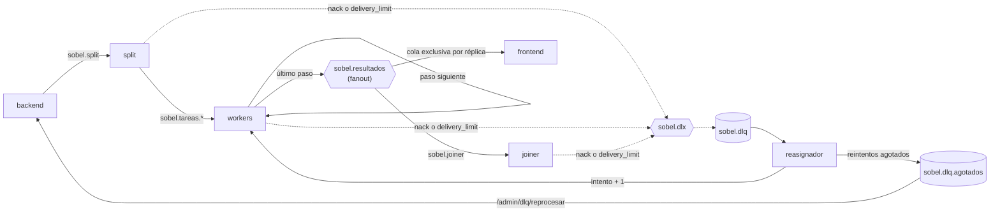
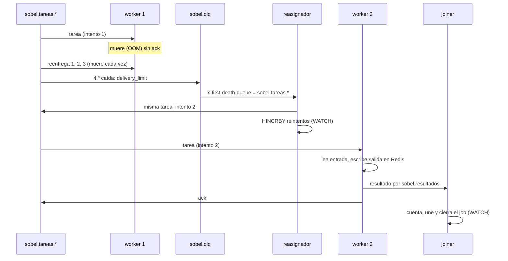
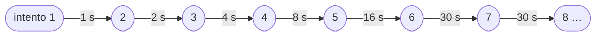

# Trabajo Práctico N° 3 — Sistemas Distribuidos y Paralelos
## Informe Individual: Mateo Nomico (Rol: Procesamiento y Mensajería)
### Teorema CAP y patrones de mensajería del Hit #3

---

## 1. Introducción

El Hit #3 procesa imágenes con un pipeline de servicios que no se hablan entre sí: se coordinan a través de **RabbitMQ**, que transporta las tareas, y de **Redis**, que guarda los píxeles y el estado de cada job. Este informe analiza qué propiedades de consistencia y disponibilidad ofrece cada uno según el teorema CAP, qué cambia cuando se los replica, y cómo esas propiedades explican decisiones concretas del código de `hit3/` (split, worker, joiner y reasignador). Al final se describen con diagramas los tres patrones de mensajería del Hit: **fanout**, **DLQ con reasignación** y **backoff exponencial**.

---

## 2. El teorema CAP

### 2.1 Enunciado
Brewer (2000) conjeturó, y Gilbert y Lynch (2002) demostraron, que un sistema de datos replicado no puede garantizar a la vez:

* **Consistencia (C):** consistencia linealizable: toda lectura ve la última escritura confirmada, como si hubiera una sola copia.
* **Disponibilidad (A):** todo pedido a un nodo que no está caído recibe una respuesta que no es un error.
* **Tolerancia a particiones (P):** el sistema sigue funcionando aunque la red pierda mensajes entre nodos.

Como en una red real las particiones ocurren y no se eligen, la lectura correcta del teorema es condicional: **cuando hay una partición**, el sistema tiene que elegir entre rechazar pedidos (CP) o responder con datos que pueden estar desactualizados o divergir (AP). Brewer (2012) insiste en esto: el "dos de tres" es engañoso, porque mientras no hay partición se pueden tener C y A a la vez.

### 2.2 PACELC
Abadi (2012) completa el teorema con el caso normal: **si hay partición (P)**, elegir entre **A** y **C**; **si no (E, *else*)**, elegir entre **latencia (L)** y **consistencia (C)**. La segunda mitad es la que se paga todos los días: replicar en forma sincrónica cuesta un viaje de red por escritura, y no hacerlo deja una ventana en la que una réplica no tiene el último dato.

---

## 3. Qué elige cada broker

### 3.1 Lo que desplegamos, sin maquillaje
En `hit3/k8s/01-rabbitmq.yaml` y `hit3/k8s/02-redis.yaml` corre **una sola réplica** de cada uno (`replicas: 1`), Redis con `--appendonly yes`. Con un único nodo no hay partición *entre réplicas* que resolver: cada broker es trivialmente consistente y, a la vez, un **punto único de falla**. Si se cae, el sistema no responde con datos viejos: espera. Los servicios reconectan con backoff (sección 5.3) y el `/health` de cada uno marca `"caido"`, así que la *readiness probe* los saca del Service. En términos de CAP, ante una partición entre un servicio y su broker el sistema se comporta como **CP**: deja de estar disponible antes que inventar un estado.

El análisis que sigue es el que importa para llevar el sistema a la nube con réplicas, que es lo que el enunciado anticipa.

### 3.2 RabbitMQ con colas *quorum*: CP
Todas nuestras colas son *quorum* (`x-queue-type: quorum`, en `hit3/comun/colas.py`). Una cola quorum se replica con **Raft**: tiene un líder y seguidores, y un mensaje se considera aceptado cuando lo escribió en disco **la mayoría** de las réplicas. Con 3 réplicas tolera la caída de 1; si una partición deja al líder en minoría, esa parte deja de aceptar publicaciones y entregas hasta que se recupera la mayoría. Es una elección explícita de **C sobre A**: RabbitMQ prefiere no responder antes que confirmar un mensaje que después podría perder o entregar dos veces por dos líderes distintos.

En PACELC es **PC/EC**: aun sin partición, el *publisher confirm* recién llega cuando la mayoría escribió el mensaje. Por eso publicar con confirms (`canal.confirm_delivery()` en `comun/conexion.py`) tarda más que publicar "y olvidarse", y es el precio de que un `basic_publish` que volvió sin error signifique que el mensaje ya no se pierde.

### 3.3 Redis con replicación asincrónica: tiende a AP
Redis replica de forma **asincrónica**: el primario responde `OK` al cliente y después le manda la escritura a las réplicas. Si el primario se cae (o queda aislado) antes de propagarla y Sentinel o el operador de la nube promueve una réplica, **esa escritura confirmada se pierde**. La documentación de Redis lo reconoce: ni con `WAIT`, que espera a que *n* réplicas reciban la escritura, Redis pasa a ser fuertemente consistente, porque un failover puede elegir una réplica que no la tenía. Durante una partición, además, un primario aislado sigue aceptando escrituras que después se descartan.

En PACELC es **PA/EL**: elige latencia. Es lo que lo hace rápido, y es por lo que no se lo puede tratar como una base transaccional replicada. Hay dos consecuencias directas para nosotros:

* **`WATCH` no protege entre nodos.** Nuestra concurrencia optimista (sección 4.3) es correcta sobre *un* primario. Si un failover pierde la escritura que cerró un job, el `WATCH` no tiene forma de saberlo.
* **La persistencia también es asincrónica.** Con `appendonly yes` y el `appendfsync everysec` por defecto, una caída del nodo puede perder hasta un segundo de escrituras, aun sin réplicas.

### 3.4 Qué cambiaríamos en la nube
* **RabbitMQ:** un clúster de 3 nodos, en zonas distintas, con las mismas colas quorum (replicación de 3). El código no cambia: ya publica con confirms y declara quorum.
* **Redis:** un servicio administrado con una réplica y failover automático, aceptando que se pierden las escrituras de los últimos milisegundos. Lo que más nos expone es que un mensaje reciba `ack` en RabbitMQ y la escritura que lo justificaba se pierda en el failover de Redis: por ejemplo, el joiner une un archivo, hace `ack` y la marca en `unidos` no llega a la réplica. La mitigación barata es `WAIT 1 <timeout>` antes del `ack` en las escrituras que cierran algo (el resultado unido y el cierre del job). No elimina el riesgo, pero lo reduce a un failover que justo elija la réplica atrasada.

---

## 4. Por qué importa en nuestra arquitectura

La elección de cada broker define **quién es la fuente de verdad**. RabbitMQ garantiza que una tarea no se pierde, pero no que se entregue una sola vez: un consumidor que muere antes del `ack` la recibe de nuevo. Redis es rápido, pero puede perder la última escritura. El diseño parte de esas dos debilidades.

### 4.1 Redis es la fuente de verdad; RabbitMQ sólo transporta
Los píxeles no viajan por RabbitMQ: el mensaje lleva la clave de Redis (`job:<id>:frag:<a>:<f>:<paso>`) y el estado de cada job vive en el hash `job:<id>` (contrato §9 y §10). Un mensaje es un aviso de "hay algo para hacer". Quien lo recibe va a Redis a ver si de verdad queda algo para hacer, y así un mensaje duplicado o tardío no puede contradecir el estado.

### 4.2 Manejadores idempotentes
Como las colas quorum dan entrega **al menos una vez**, todo manejador tiene que poder recibir el mismo mensaje dos veces sin romper nada:

* **Worker:** si la tarea vuelve y la entrada sigue en Redis, repite el paso y pisa la salida con los mismos bytes. Si la entrada ya no está pero la salida sí, sólo vuelve a publicar el paso siguiente. Si no hay ninguna de las dos, hace `ack` sin tocar nada.
* **Joiner:** un fragmento duplicado no suma a `completos` (se cuenta con `SADD` a `listos` en la misma transacción), pero igual se revisa si hay algo para unir o cerrar, porque el original pudo haberse contado justo antes de una caída.

### 4.3 "Primero el dato, después la marca"
Cada servicio escribe el resultado antes de anotar que terminó, y borra lo viejo al final. El joiner escribe `resultado:<a>`, después agrega el archivo a `unidos` y recién entonces borra los fragmentos del último paso. Una caída en cualquier punto deja un estado del que la reentrega se recupera: o los fragmentos siguen ahí y se vuelve a unir, o el archivo ya está marcado y no hay nada más que hacer.

### 4.4 `WATCH` para lo que tiene que pasar una sola vez
Lo que no es idempotente (sumar un contador, cerrar un job, agregar una entrada a `terminados`) va en una transacción con `WATCH`. El cierre del joiner, simplificado:

```python
def cerrar(transaccion):
    if transaccion.hget(clave_job, "estado") in (b"done", b"failed"):
        return False                     # otra réplica ya lo cerró
    transaccion.multi()
    transaccion.hset(clave_job, mapping={"estado": "done", "terminado": ahora_ms})
    transaccion.lpush("terminados", f"done {ms_totales}")
    return True

redis.transaction(cerrar, clave_job, value_from_callable=True)  # reintenta si alguien tocó el job
```

Si dos réplicas del joiner ven a la vez el último archivo unido, sólo una pasa el `EXEC`. Lo mismo hace el reasignador al pasar un job a `dlq` o a `failed`, y además **no recrea** un job que venció: un `HINCRBY` sobre una clave inexistente la crearía sin TTL.

### 4.5 TTL en todo
Todas las claves `job:<id>*` vencen a las 24 h (`SOBEL_TTL`). Es la red de seguridad de los estados que la idempotencia no limpia: fragmentos que quedaron porque el joiner se cayó entre `unidos` y el borrado, o un job que quedó en `processing` porque Redis perdió una escritura.

### 4.6 Límite de entregas y confirms
Una cola quorum cuenta las reentregas de un mensaje cuyo consumidor murió con él en la mano. Con `x-delivery-limit: 3` (configurable con `SOBEL_LIMITE_ENTREGAS`), la cuarta caída lo manda a la DLQ en vez de reintentarlo para siempre: un fragmento que mata al worker por OOM no tumba a todos los workers en cadena.

### 4.7 Riesgos aceptados y documentados
* **`en_dlq` una por debajo:** el reasignador publica en `sobel.dlq.agotados` antes de escribir en Redis (perder la tarea sería peor que contarla mal). Si se cae entre las dos cosas, el contador queda uno por debajo de lo que hay en la cola.
* **`NackError`:** si el broker rechaza la publicación del reintento, la tarea se descarta con el error en el log. Reencolarla podría ciclar para siempre, porque un `nack` con reencolado no cuenta para el límite de entregas.
* **`t_join_ms` de más:** dos réplicas pueden unir el mismo archivo a la vez. Escriben los mismos bytes, y sólo se distorsiona un tiempo informativo.

---

## 5. Patrones de mensajería del Hit #3

### 5.1 El flujo y sus tres patrones



Las líneas punteadas son lo que RabbitMQ manda a la DLQ por su cuenta. Todos los servicios, además, leen y escriben en Redis, y se conectan a los dos brokers con backoff (sección 5.3).

* **Fanout:** el último paso de cada fragmento se publica una sola vez en el exchange `sobel.resultados`, y RabbitMQ lo copia a dos destinos que no se conocen. En `sobel.joiner` las réplicas del joiner **compiten** por cada mensaje; cada réplica del frontend tiene su propia cola exclusiva y recibe **todos** los mensajes, para mostrar el progreso.
* **DLQ y reasignación:** las colas de trabajo tienen como *dead-letter exchange* a `sobel.dlx`. Lo que un consumidor rechaza, o lo que lo mata más veces que el límite, termina en `sobel.dlq`. El reasignador distingue el origen por el header `x-first-death-queue`: una tarea se reencola con un intento más hasta `SOBEL_REINTENTOS_MAX`, y un job del split o un fragmento del joiner, que no se arreglan reintentando, pasan el job a `failed`.
* **Backoff exponencial:** toda conexión a RabbitMQ o a Redis (`con_backoff` en `comun/conexion.py`) se reintenta esperando cada vez el doble, con tope.

### 5.2 Secuencia de una falla



Lo verificamos contra RabbitMQ 4 real, con la prueba de humo de `.scratch/humo/` y `x-delivery-limit: 0`: la primera caída del consumidor ya manda el mensaje a la DLQ, y el job termina en `done` procesado por otro worker.

### 5.3 Línea de tiempo del backoff



Las esperas son 1, 2, 4, 8 y 16 s; a partir de ahí se quedan en 30 s (`ESPERA_MAXIMA`). El intento 7 llega a los 61 s de la primera falla. Cada intento se loguea con su espera. La subida exponencial evita que, si el broker se reinicia, cientos de pods lo golpeen a la vez mientras arranca, y el tope evita que un servicio tarde minutos en volver después de que el broker ya está listo. Los errores de credenciales no se reintentan: una contraseña equivocada no se arregla esperando.

El backoff es sólo para **conexiones**. Una tarea que falla se reintenta enseguida en otra cola; no le hace falta esperar, porque el límite de reintentos ya corta los ciclos.

---

## 6. Conclusiones

RabbitMQ con colas quorum y Redis replicado hacen elecciones opuestas: el primero prefiere no responder antes que perder un mensaje confirmado (CP, y EC sin partición), y el segundo prefiere responder rápido aunque un failover pierda la última escritura (AP, y EL sin partición). Nuestra arquitectura usa a cada uno para lo que garantiza. RabbitMQ asegura que ninguna tarea se pierda, pero puede entregarla más de una vez; Redis guarda los datos, pero se le pide sólo atomicidad sobre un nodo. Entre los dos, la consistencia del sistema descansa en tres reglas del código: manejadores idempotentes, primero el dato y después la marca, y `WATCH` para lo que tiene que pasar una sola vez. Con un nodo de cada uno, como hoy, esto alcanza. Con réplicas en la nube, el próximo paso es acotar con `WAIT` la ventana en la que Redis puede perder una escritura que RabbitMQ ya dio por hecha.

---

## 7. Registro de uso de herramientas de IA

1. **Herramienta:** Claude Code (Anthropic), en todas las tareas de M1 a M8.
2. **Cómo se usó:**
   * **Specs:** cada servicio arrancó con una spec discutida pregunta por pregunta antes de escribir código (el contrato de `hit3/contrato.md` salió de ahí).
   * **Tests primero:** cada comportamiento se escribió primero como un test en rojo. Cuando un test pasó sin haber fallado nunca, se rompió el código a propósito para comprobar que lo detectaba.
   * **Revisión:** en cada ticket, dos subagentes revisaron por separado el cumplimiento de las reglas del grupo y el de la spec, y encontraron errores reales (un contador que podía quedar en −1, un `TypeError` en el cierre del joiner).
   * **Este informe:** la estructura y la redacción, a partir de decisiones tomadas por mí.
3. **Lo que verificamos a mano o contra RabbitMQ 4 real** (y no tomamos de la IA ni de la documentación): que con `x-delivery-limit: 0` la primera caída del consumidor manda el mensaje a la DLQ; que un `nack` con reencolado no cuenta para el límite de entregas; y que `x-first-death-queue` llega como texto. Las tres cosas están ahora en el contrato.
4. **Supervisión:** todo el código pasó por los tests del CI y por la revisión del grupo antes de mergearse a `dev`. La arquitectura y las decisiones de diseño son del grupo.

---

## Referencias

* Brewer, E. (2000). *Towards Robust Distributed Systems*. Keynote, PODC.
* Brewer, E. (2012). CAP Twelve Years Later: How the "Rules" Have Changed. *IEEE Computer*, 45(2), 23–29.
* Gilbert, S. y Lynch, N. (2002). Brewer's Conjecture and the Feasibility of Consistent, Available, Partition-Tolerant Web Services. *ACM SIGACT News*, 33(2), 51–59.
* Abadi, D. (2012). Consistency Tradeoffs in Modern Distributed Database System Design. *IEEE Computer*, 45(2), 37–42.
* RabbitMQ. *Quorum Queues*, *Publisher Confirms*, *Dead Letter Exchanges*. https://www.rabbitmq.com/docs
* Redis. *Replication*, *WAIT*, *Persistence*. https://redis.io/docs

---
*Mateo Nomico — Grupo Cerberus (SDyPP 2026)*
