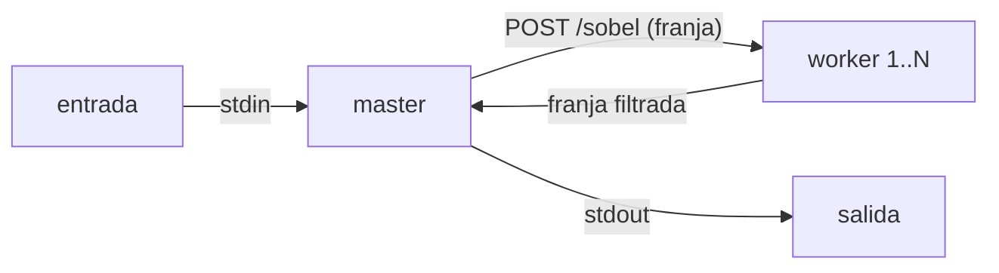

# Hit #1 — Operador de Sobel

```bash
python centralizado.py entrada.jpg salida.png                    # Etapa 1

docker compose up -d --build --wait --scale worker=4 worker      # Etapa 2 (Docker)
docker compose run --rm -T master < entrada.jpg > salida.png

docker save sobel-hit1:local | sudo k3s ctr images import -      # Etapa 2 (k3s)
kubectl apply -f k8s/sobel.yaml
kubectl run sobel-master -n sobel --rm -i -q --restart=Never --image=sobel-hit1:local \
  --env=SOBEL_WORKERS=sobel-worker:8080 -- python master.py - - < entrada.jpg > salida.png
```

Opciones del master: `SOBEL_PARTES` (default: una franja por worker), `SOBEL_TIMEOUT` (30 s).
Tests: `pytest` y `bash tests/integracion.sh`.



## Decisiones

- Franjas horizontales con una fila de borde extra, que el master recorta al unir: sale idéntico a la Etapa 1.
- Magnitud recortada a 0-255, no normalizada por el máximo de cada franja.
- El master encuentra los workers por DNS (`--scale` en Compose, Service headless en k3s).
- Imagen por stdin/stdout: sin volúmenes.

## Prerrequisitos cumplidos (Parte 0)

k3s v1.36.4 (containerd), 07/10/2026: nodo `Ready` · nginx-test 2/2 con `curl localhost:8080` → 200 ·
pod borrado y recreado por el Deployment · imágenes importadas con `k3s ctr images import` · rolling update a `nginx:1.25-alpine`.
