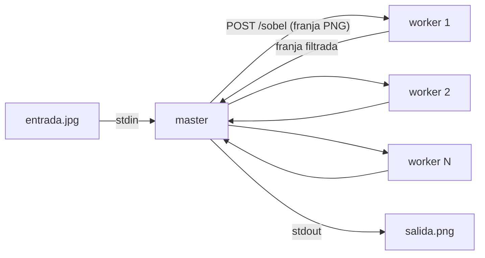

# Hit #1 — Operador de Sobel

Python 3.14 + numpy + Pillow. Todo se ejecuta desde `hit1/`.

## Etapa 1 — Centralizado

```bash
pip install -r requirements.txt
python centralizado.py entrada.jpg salida.png
```

## Etapa 2 — Distribuido (Master-Worker sobre Docker y k3s)

```bash
docker compose up -d --build --wait --scale worker=4 worker   # N workers
docker compose run --rm -T master < entrada.jpg > salida.png   # una franja por worker
SOBEL_PARTES=8 docker compose run --rm -T master < entrada.jpg > salida.png
docker compose down
```



### En Kubernetes (k3s)

```bash
docker compose build && docker save sobel-hit1:local | sudo k3s ctr images import -
kubectl apply -f k8s/sobel.yaml                                  # 4 workers + Service headless
kubectl scale deploy/sobel-worker -n sobel --replicas=N          # opcional
kubectl run sobel-master -n sobel --rm -i -q --restart=Never \
  --image=sobel-hit1:local --image-pull-policy=IfNotPresent \
  --env=SOBEL_WORKERS=sobel-worker:8080 -- python master.py - - < entrada.jpg > salida.png
kubectl delete -f k8s/sobel.yaml
```

El master es un pod efímero por imagen (como `compose run --rm`). El Service es headless para que
el DNS devuelva un pod por worker y el master reparta él.

| Variable | Default | |
|---|---|---|
| `SOBEL_WORKERS` / `--workers` | `worker:8080` | `host:puerto` separados por coma |
| `SOBEL_PARTES` / `--partes` | una por worker | cantidad de franjas |
| `SOBEL_TIMEOUT` / `--timeout` | `30` | segundos por franja |

Worker: `POST /sobel` (imagen → PNG filtrado) y `GET /health` → `{"worker": "ok"}`.

## Decisiones de diseño

- **Franjas horizontales con una fila de borde** arriba y abajo: Sobel mira los 8 vecinos. El master
  recorta esas filas al unir, y el resultado es idéntico píxel a píxel al de la Etapa 1 (lo prueban los tests).
- **Magnitud recortada a 0-255**, sin normalizar por el máximo: con el máximo de cada franja, las
  franjas no coincidirían entre sí.
- **Descubrimiento por DNS**: `worker` (Compose) o `sobel-worker` (Service headless) resuelve a una IP por réplica; el master reparte en round-robin, un hilo por franja.
- **Imagen por stdin/stdout**: no hace falta montar volúmenes ni pelear con permisos.
- Una sola imagen Docker para master y worker, usuario no-root.
- Logs a consola, buffer en memoria (500 líneas) y `logs/<proceso>.log` rotativo.

## Prerrequisitos cumplidos (Parte 0)

k3s v1.36.4+k3s1 nativo (containerd) en CachyOS, validado el 07/10/2026.

| Checkpoint | Evidencia |
|---|---|
| Nodo `Ready` | `kubectl get nodes` → `cachyos-x8664   Ready   control-plane   v1.36.4+k3s1` |
| nginx-test con `replicas: 2` en `localhost:8080` | 2/2 pods `Running`; `curl localhost:8080` (port-forward) → `200`, "Welcome to nginx!" |
| Auto-healing | `kubectl delete pod nginx-test-…-4vpsf` → el Deployment crea `nginx-test-…-czzv4` (`SuccessfulCreate`) |
| Importar imágenes | `docker save … \| sudo k3s ctr images import -`; la de este Hit es `sobel-hit1:local` |
| Rolling update | `kubectl set image … nginx=nginx:1.25-alpine` → 2 pods nuevos, revisión 2 |

## Tests

```bash
pip install -r requirements-dev.txt
python -m pytest -v          # Sobel, partición y master + 3 workers en hilos
bash tests/integracion.sh    # Docker: 3 workers, compara con la Etapa 1
```
