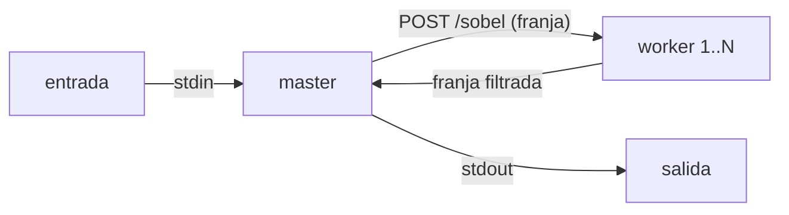
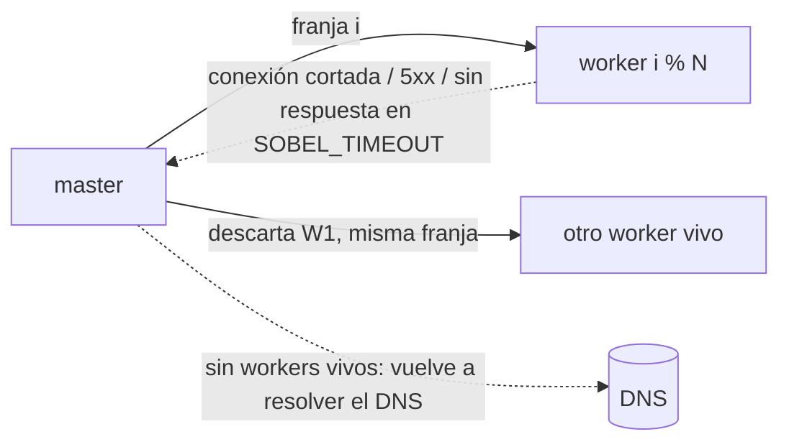

# Hit #1 — Operador de Sobel

```bash
python centralizado.py entrada.jpg salida.png                    # Etapa 1

docker compose up -d --build --wait --scale worker=4 worker      # Etapa 2 (Docker)
docker compose run --rm -T master < entrada.jpg > salida.png

docker save sobel-hit1:local | sudo k3s ctr images import -      # Etapa 2 (k3s)
kubectl apply -f k8s/sobel.yaml
kubectl run sobel-master -n sobel --rm -i -q --restart=Never --image=sobel-hit1:local \
  --env=SOBEL_WORKERS=sobel-worker:8080 -- python master.py - - < entrada.jpg > salida.png

docker compose --profile fallas up -d --build --wait --scale worker=2   # Etapa 3 (Docker)
SOBEL_TIMEOUT=3 docker compose run --rm -T master < entrada.jpg > salida.png

kubectl apply -f k8s/sobel.yaml -f k8s/fallas.yaml                       # Etapa 3 (k3s)
kubectl run sobel-master -n sobel --rm -i -q --restart=Never --image=sobel-hit1:local \
  --env=SOBEL_WORKERS=sobel-worker:8080 --env=SOBEL_TIMEOUT=3 -- python master.py - - < entrada.jpg > salida.png
```

Opciones del master: `SOBEL_PARTES` (default: una franja por worker), `SOBEL_TIMEOUT` (30 s: sin respuesta
en ese tiempo, el worker se da por caído).
Fallas simuladas del worker: `SOBEL_FALLA=caida` (termina al recibir una franja), `SOBEL_FALLA=colgado`
(nunca responde la franja) y `SOBEL_DEMORA=<s>` (demora por franja, para matar un worker a mano a mitad
del trabajo: `kubectl set env deployment/sobel-worker -n sobel SOBEL_DEMORA=4` y
`kubectl delete pod <pod> -n sobel --grace-period=0 --force`).
Tests: `pytest`, `bash tests/integracion.sh` y `bash tests/tolerancia.sh`.



## Decisiones

- Franjas horizontales con una fila de borde extra, que el master recorta al unir: sale idéntico a la Etapa 1.
- Magnitud recortada a 0-255, no normalizada por el máximo de cada franja.
- El master encuentra los workers por DNS (`--scale` en Compose, Service headless en k3s).
- Imagen por stdin/stdout: sin volúmenes.

### Etapa 3 — tolerancia a fallos



- **Detección**: un worker está caído si rechaza o corta la conexión, responde 5xx o algo que no es
  imagen, o no responde en `SOBEL_TIMEOUT` (colgado: `/health` puede seguir contestando). Un 4xx no
  cuenta: la franja es inválida y reasignarla no lo arregla.
- **Reasignación**: el worker se descarta hasta el final del trabajo y la franja va al siguiente vivo
  (round-robin entre los vivos). El trabajo falla sólo si no queda ninguno.
- **Redescubrimiento**: sin workers vivos, el master vuelve a resolver el DNS antes de rendirse. En k3s el
  Deployment recrea el pod muerto con otra IP y el Service headless la publica.
- **Costo**: las franjas del worker colgado vencen en paralelo, así que se pierde un timeout, no uno
  por franja. El peor caso es una franja que cae en un colgado todavía no detectado y espera dos.
- El timeout tiene que superar lo que tarda una franja: si no, un worker lento pero sano se descarta.
- **Apagado ordenado**: con SIGTERM (rollout, scale down, `kubectl delete pod`, `docker stop`) el worker
  deja de aceptar franjas, termina las que tiene en curso y sale con 0, así que un apagado planificado no
  le cuesta ninguna reasignación al master. Sin el handler, Python como PID 1 ignora SIGTERM: cada pod
  tardaba los 30 s de gracia en morir y el SIGKILL cortaba la franja que estuviera procesando.

Evidencia (`tests/tolerancia.sh`, 8 franjas, 2 sanos + 1 caído + 1 colgado, `SOBEL_TIMEOUT=3`):

```
franja 7/8: el worker 172.24.0.4:8080 no está disponible: Remote end closed connection without response → worker descartado, la franja se reasigna
franja 7/8 (37 filas) → 172.24.0.2:8080 en 0.002 s (intento 2)
franja 4/8: el worker 172.24.0.5:8080 no respondió en 3 s → worker descartado, la franja se reasigna
franja 4/8 (38 filas) → 172.24.0.2:8080 en 0.003 s (intento 2)
4 reasignaciones; workers descartados: 172.24.0.4:8080, 172.24.0.5:8080
OK: salida idéntica a la centralizada con un worker caído y otro colgado
```

El mismo script mata con `docker kill` un worker sano mientras procesa: sus 2 franjas se reasignan y la
salida también es idéntica a la de la Etapa 1.

En k3s (14/10/2026), con 4 sanos + `k8s/fallas.yaml` y 12 franjas: 4 reasignaciones, salida idéntica, y
el Deployment reinició el pod caído (`RESTARTS 1`). Borrando un pod a mitad del trabajo con
`--grace-period=0 --force`: sus 2 franjas se reasignan, la salida es idéntica y el Deployment crea otro pod.
Un `kubectl delete pod` normal no simula una caída: es un apagado ordenado (ver abajo) y el worker
termina sus franjas antes de salir.

## Prerrequisitos cumplidos (Parte 0)

k3s v1.36.4 (containerd), 07/10/2026: nodo `Ready` · nginx-test 2/2 con `curl localhost:8080` → 200 ·
pod borrado y recreado por el Deployment · imágenes importadas con `k3s ctr images import` · rolling update a `nginx:1.25-alpine`.
