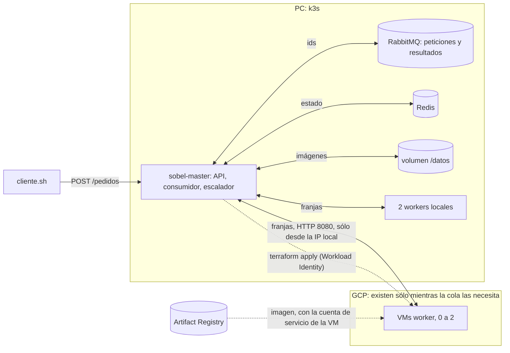

# Hit #2 — Sobel con offloading a la nube

```bash
./construir.sh && docker save sobel-hit2:local | sudo k3s ctr images import -   # la imagen del master
k8s/desplegar.sh                                   # RabbitMQ, Redis, el master y 2 workers locales, en k3s
SOBEL_RITMO=3.5 ./cliente.sh <carpeta con fotos>   # pedidos; escribir 4.7 y después 5.9 (Enter) para que suban VMs
```

El master del [Hit #1](../hit1/README.md) queda corriendo en k3s como servicio, en `localhost:30080`. Recibe los
pedidos, los encola y reparte cada imagen en franjas entre los workers locales y las VMs de GCP que crea según la cola.
Para crear VMs necesita `infra/base` aplicado con la clave pública de k3s
(`-var "k3s_jwks=$(kubectl get --raw /openid/v1/jwks)"`, ver [`infra/`](../infra/README.md)); sin eso trabaja sólo con
los locales.

| | |
|---|---|
| `POST /pedidos?costo=N` | la imagen en el cuerpo → `202 {id}`; `400` si no es imagen, `507` si no hay lugar en disco |
| `GET /pedidos/<id>` | estado (`queued`, `processing`, `done`, `failed`), tiempos y workers que participaron |
| `GET /pedidos/<id>/resultado` | el PNG con bordes, durante 10 min |
| `GET /estado` | pedidos en cola, atendidos por segundo, latencia media, disco usado y VMs |
| `GET /health` | `{"master", "rabbitmq", "redis", "disco"}` |



## Decisiones

- **El master como servicio.** Un proceso con la API, el consumidor de `sobel.peticiones`, el escalador y la limpieza
  del disco. Una réplica con `Recreate`: dos escaladores se pelearían por las VMs.
- **A la cola va sólo el id.** La imagen va al disco del master (un PVC `local-path`) y el estado a Redis, que con las
  fotos de 100 MB de la demo pasaba de 3 GiB y moría (OOMKilled). En disco, los resultados viven 10 min, quedan
  como mucho 100, y una limpieza cada 30 s borra lo vencido; con más de 20 GB, un pedido nuevo recibe `507`.
  El `ack` va recién después de guardar el resultado: si el master se cae a mitad de un pedido, vuelve a la cola.
- **Escalado por el largo de la cola**, que es el trabajo pendiente real: no pesan lo mismo 3 fotos de 1 MB que 3 de
  100 MB. Cada 5 s, una VM cada `SOBEL_UMBRAL` (3) pedidos en espera, hasta `SOBEL_MAX_VMS` (2). Una VM tarda ~60 s
  en atender y en ese tiempo la cola crece ~1 más; además sube y baja de a uno con cada pedido. Con 3, la cola se
  queda quieta en 2–4 con una VM sin llegar al 6 que lanza la segunda. Cada VM se mantiene hasta que la cola baja
  más de `SOBEL_MARGEN` (1) de su umbral durante 30 s (como la ventana del HPA); antes de borrarla la saca de la
  lista de workers y espera al pedido en curso.
- **Ciclo de cada VM:** provisioning (`terraform apply` desde el pod), bootstrap y deploy
  ([`arranque.sh.tftpl`](infra/arranque.sh.tftpl): Container-Optimized OS ya trae Docker, así que sólo baja la imagen),
  join (cuando responde `/health` entra en los pedidos siguientes) y teardown (menos VMs, o 0 cuando el master recibe
  SIGTERM). El apply de `main` en el CI deja `cantidad = 0` sobre el mismo estado: no mergear a `main` con VMs prendidas.
- **Sin claves.** El pod cambia el token de su ServiceAccount de k3s por credenciales temporales de `sobel-ci`
  (Workload Identity, pool `k3s-local`). Las VMs bajan la imagen con su propia cuenta de servicio, que sólo puede leer.
- **Velocidades comparables.** Una VM `e2-standard-2` procesa una franja unas 2,3 veces más lento que un núcleo de
  la PC; cada worker local se limita a 450m para que rindan igual y la diferencia sea la cantidad de workers.
  `SOBEL_COSTO` (Hit #1) simula una tarea más pesada con el mismo resultado. En CachyOS el planificador `scx_lavd`
  ignora los límites de CPU: apagarlo antes (`systemctl stop scx_lavd`).
- **Qué queda local y qué va a la nube:** el master, la cola y los datos quedan en la PC; los workers son CPU pura,
  sin estado y reemplazables. La justificación completa por servicio está en el informe.
- **Red.** Los workers del Hit #1 no tienen autenticación: el firewall abre el 8080 sólo a la IP pública local.

## La demo (29/10/2026)

Las 80 fotos de 100 MB, costo 5, 2 workers locales de 450m y VMs `e2-standard-2` en `southamerica-east1-a`. Mientras
corre el cliente se escribe el ritmo en pedidos por minuto. Todas las salidas fueron idénticas a la centralizada y al
final quedaron 0 VMs.

| Ritmo | Qué pasa |
|---|---|
| X = 3,5 | los 2 locales solos (3,7/min, 16,3 s por pedido): la cola queda en 0–1, sin VMs |
| Y = 4,7 | a los ~2,5 min la cola llega a 3 y se lanza una VM; con 3 workers (4,6–4,85/min) queda quieta en 2–3 |
| Z = 5,9 | a los ~3,5 min la cola llega a 6 y se lanza la segunda; con 4 workers (5,8–6/min) queda en 4–6 |
| Z → Y → X | cada VM se borra ~1 min después de bajar el ritmo |

Las VMs no rinden siempre igual: Y y Z están en el medio de lo medido, así la cola tarda decenas de minutos en llegar
a otro umbral. La versión anterior, que procesaba una sola imagen con N VMs (`desbordar.sh`), quedó en el tag
[`v1.0.0`](https://github.com/chimera-sdypp/sdypp_tp3/tree/v1.0.0/hit2), y sus mediciones están en el informe.
