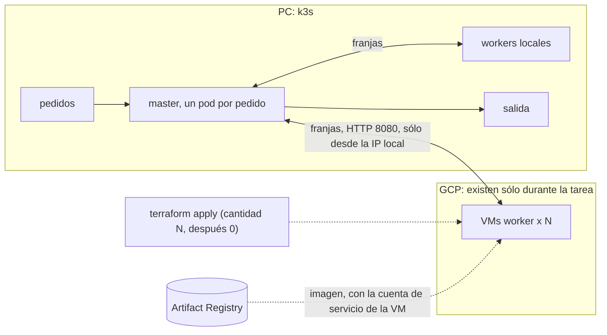

# Hit #2 — Sobel con offloading a la nube

```bash
cp infra/terraform.tfvars.example infra/terraform.tfvars        # proyecto, imagen e IP pública propia
terraform -chdir=infra init -backend-config="bucket=<proyecto>-tfstate"
kubectl apply -f ../hit1/k8s/sobel.yaml                          # los workers locales, en k3s
./desbordar.sh 3 entrada.jpg salida.png                          # una imagen: 3 workers en la nube + los locales

./pedidos.sh 20 fotos/ cola/ &                                   # pedidos cada vez más seguidos…
SOBEL_COSTO=10 ./cola.sh cola/ salidas/                          # …y VMs según cuántos esperan (hasta 4)
```

Usa el master y el worker del [Hit #1](../hit1/README.md): los workers locales son su Deployment en k3s y el master
corre como un pod por pedido ([`master.sh`](master.sh)). La preparación de GCP (bucket del estado, registry, OIDC)
está en [`infra/`](../infra/README.md).



## Decisiones

- **Cloud bursting.** Los workers locales atienden siempre; `desbordar.sh` suma N VMs para una imagen y las destruye
  al terminar, aunque algo falle (`trap`). El master recibe la lista `--workers local,nube` y reparte entre todos.
- **Ciclo de cada VM:** provisioning (`terraform apply -var cantidad=N`), bootstrap y deploy
  ([`arranque.sh.tftpl`](infra/arranque.sh.tftpl): Container-Optimized OS ya trae Docker, así que sólo baja la imagen),
  join (la salida `workers` va al master) y teardown (`cantidad=0`). En el CI `cantidad` queda en 0: el apply de
  `main` no deja VMs prendidas.
- **Según la demanda** (`cola.sh`). Atiende los pedidos de a uno, cada uno repartido entre todos los workers. Cada 5 s
  ajusta las VMs a una cada 2 pedidos en espera, hasta `SOBEL_MAX_VMS` (4, por la cuota de IPs de la región). Desde
  2 en espera, cuando la cola ya no se vacía sola, y sin esperar a que crezca más: una VM tarda poco más de 1 minuto
  en estar lista y, si se la pide tarde, llega cuando ya no hace falta. Sube enseguida y baja recién tras 30 s pidiendo
  menos (como la ventana de estabilización del HPA), para no borrar una VM que vuelve a hacer falta. Antes de borrar
  una la saca de la lista de workers y espera al pedido en curso, así ninguna franja queda en una VM que desaparece.
  Con cada pedido terminado muestra los pedidos en cola, los atendidos por segundo en el último minuto y la latencia
  media (de la llegada al resultado).
- **Velocidades comparables.** Una VM `e2-standard-2` procesa una franja unas 2,3 veces más lento que un núcleo de
  la PC; el worker local se limita a 450m (`kubectl set resources`) para que rindan igual y la diferencia sea la
  cantidad de workers. `SOBEL_COSTO` (Hit #1) simula una tarea más pesada con el mismo resultado. En la PC donde
  se probó (CachyOS), el planificador `scx_lavd` ignora los límites de CPU: apagarlo antes (`systemctl stop scx_lavd`).
- **Qué queda local y qué va a la nube:** el master tiene la imagen y la salida, y su trabajo es liviano; los workers
  son CPU pura, sin estado y reemplazables. La justificación completa por servicio está en el informe.
- **Sin claves en las VMs.** Bajan la imagen de Artifact Registry con su cuenta de servicio, que sólo puede leer.
- **Red.** Los workers del Hit #1 no tienen autenticación: el firewall abre el 8080 sólo a la IP pública local.

## Resultados (GCP, 28/10/2026)

1 worker local más N VMs `e2-standard-2` en `southamerica-east1-a`; tiempo del master, sin el arranque de las VMs
(93 a 140 s). Las salidas son idénticas a la centralizada y cada corrida termina con 0 VMs.

| Imagen | 1 local | 2 locales | 1 local + 1 VM | 1 local + 2 VMs |
|---|---|---|---|---|
| 10 MB (1850×1850) | 1,31 s | 0,86 s | 1,75 s | 1,54 s |
| 50 MB (4150×4150) | 6,12 s | 4,55 s | 6,40 s | 5,26 s |

Una franja en la nube tarda 2 a 4 veces más que en la PC por el viaje por Internet: desbordar sólo conviene cuando
la capacidad local está saturada y las VMs se mantienen mientras dura la carga. El análisis está en el informe.
