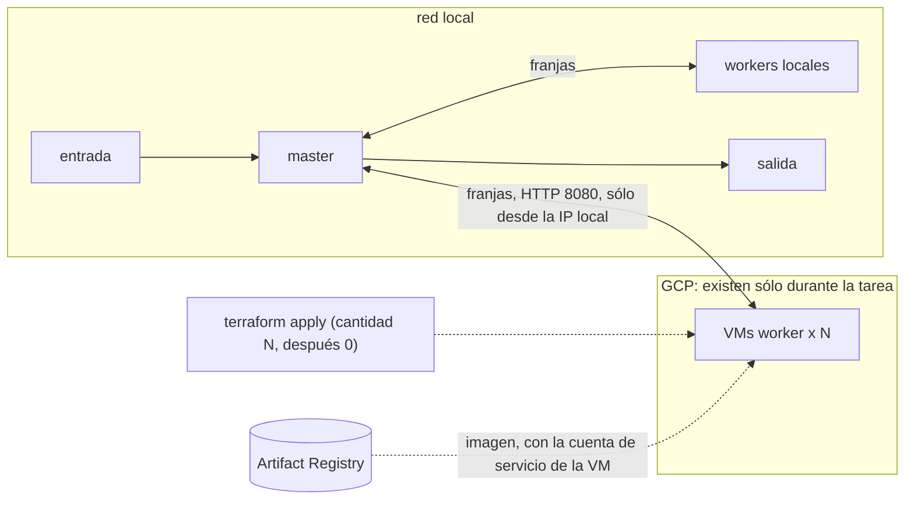

# Hit #2 — Sobel con offloading a la nube

```bash
cp infra/terraform.tfvars.example infra/terraform.tfvars        # proyecto, imagen e IP pública propia
terraform -chdir=infra init -backend-config="bucket=<proyecto>-tfstate"
./desbordar.sh 3 entrada.jpg salida.png                          # 3 workers en la nube + los locales
```

Usa el master y el worker del [Hit #1](../hit1/README.md) sin cambios. La preparación de GCP (bucket del estado,
registry, OIDC) está en [`infra/`](../infra/README.md).



## Decisiones

- **Cloud bursting.** Los workers locales atienden siempre; `desbordar.sh` suma N VMs para una imagen y las destruye
  al terminar, aunque algo falle (`trap`). El master recibe la lista `--workers local,nube` y reparte entre todos.
- **Ciclo de cada VM:** provisioning (`terraform apply -var cantidad=N`), bootstrap y deploy
  ([`arranque.sh.tftpl`](infra/arranque.sh.tftpl): Docker y la imagen), join (la salida `workers` va al master) y
  teardown (`cantidad=0`). En el CI `cantidad` queda en 0: el apply de `main` no deja VMs prendidas.
- **Qué queda local y qué va a la nube:** el master tiene la imagen y la salida, y su trabajo es liviano; los workers
  son CPU pura, sin estado y reemplazables. La justificación completa por servicio está en el informe.
- **Sin claves en las VMs.** Bajan la imagen de Artifact Registry con su cuenta de servicio, que sólo puede leer.
- **Red.** Los workers del Hit #1 no tienen autenticación: el firewall abre el 8080 sólo a la IP pública local.
