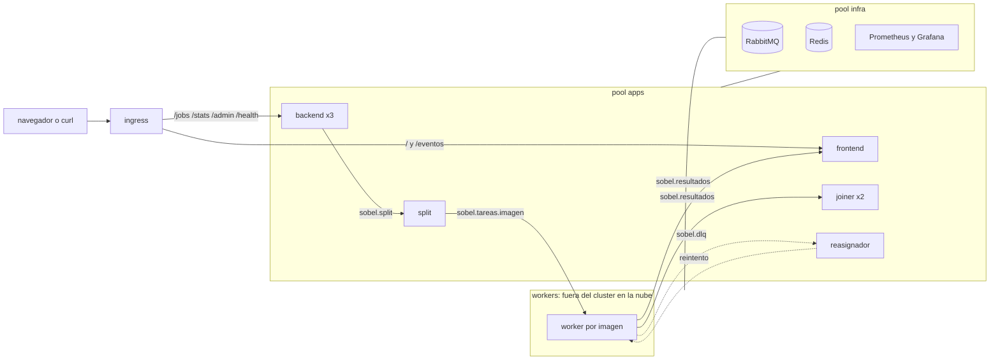

# Hit #3 — Sobel asincrónico en Kubernetes

```bash
NODO=$(kubectl get nodes -o jsonpath='{.items[0].metadata.name}')
kubectl label nodes "$NODO" sobel/infra=true sobel/apps=true --overwrite   # k3s de un nodo
GHCR_USER=<usuario> GHCR_PAT=<token read:packages> hit3/k8s/crear_secretos.sh
kubectl apply -k hit3/k8s/

TOKEN=$(kubectl -n sobel exec deploy/backend -- python -m backend.emitir_token ana usuario)
curl -s -X POST http://localhost/jobs -H "Authorization: Bearer $TOKEN" -F archivos=@gato.png \
  -F 'operaciones=[{"operacion":"grises","imagen":"ghcr.io/chimera-sdypp/sobel-worker:1.0.0"},
                   {"operacion":"sobel","imagen":"ghcr.io/chimera-sdypp/sobel-worker:1.0.0"}]'
curl -s http://localhost/jobs/<job_id> -H "Authorization: Bearer $TOKEN"
```

O desde el navegador en `http://localhost/`: se pega el token, se suben las imágenes y se ve avanzar el job.
La API completa, los errores y las interfaces entre servicios están en el [contrato](contrato.md); el despliegue,
en [k8s/](k8s/README.md); la observabilidad, en el [Hit #4](../hit4/README.md).

Tests: `pytest` en cada carpeta de servicio, y `pytest -m integracion` con `RABBITMQ_URL` y `REDIS_URL`.
Evidencia: [`evidencia/r1.sh`](evidencia/r1.sh) (registry privado) y [`evidencia/r4.sh`](evidencia/r4.sh) (roles y
réplicas sin estado).



Las flechas entre servicios son colas de RabbitMQ; los píxeles y el estado de cada job viven en Redis.

## Decisiones

- **Asincrónico.** `POST /jobs` valida todo, guarda las imágenes en Redis, encola y responde `202` al instante. El
  estado se consulta con `GET /jobs/{id}`; la página además recibe cada fragmento terminado por Server-Sent Events.
- **Una cola por imagen de worker** (`sobel.tareas.<imagen>`). El pedido elige operación e imagen en cada paso, y dos
  versiones del worker pueden convivir (R2). Cada worker anota en Redis su imagen y sus operaciones, y el backend
  rechaza antes de encolar lo que nadie ofrece.
- **Los píxeles van por Redis**, no por RabbitMQ: los mensajes llevan claves y quedan chicos.
- **Fragmentos con filas de borde.** El split agrega una fila arriba y abajo por cada operación de vecindad y el joiner
  las recorta: el resultado es idéntico al del Hit #1.
- **Fallas.** Colas quorum con `x-delivery-limit`: un worker que muere o hace `nack` manda el fragmento a la DLQ. El
  reasignador lo vuelve a encolar con espera de 1, 2, 4, 8… s (tope 30 s) y, si agota los intentos, lo pasa a
  `sobel.dlq.agotados` y el job queda en `dlq` hasta que un admin lo reprocese. Nunca reintenta sin límite. El split
  y el joiner también mandan a la DLQ lo que no pueden procesar, pero eso no se arregla reintentando: el job pasa a
  `failed`.
- **Fanout de resultados.** `sobel.resultados` llega al joiner (una cola compartida: compiten sus réplicas) y al
  frontend (una cola exclusiva por réplica: cada una ve todos los resultados).
- **Backend sin estado (R4).** La identidad viaja en cada pedido (JWT HS256 con rol) y el límite por usuario se cuenta
  en Redis, así que da lo mismo qué réplica atiende. Un job ajeno da `404`, no `403`.
- **Sin credenciales en el repo.** Las imágenes son privadas en GHCR y el CI las publica con el `GITHUB_TOKEN` del job,
  que vence al terminar. `crear_secretos.sh` genera las claves de RabbitMQ, Redis y JWT y las guarda sólo en el
  cluster. gitleaks corre en cada push.
- **Probes.** `readiness` mira `/health` (RabbitMQ y Redis conectados); `liveness` sólo el puerto, para que una caída
  del broker no reinicie todos los pods en cadena.
