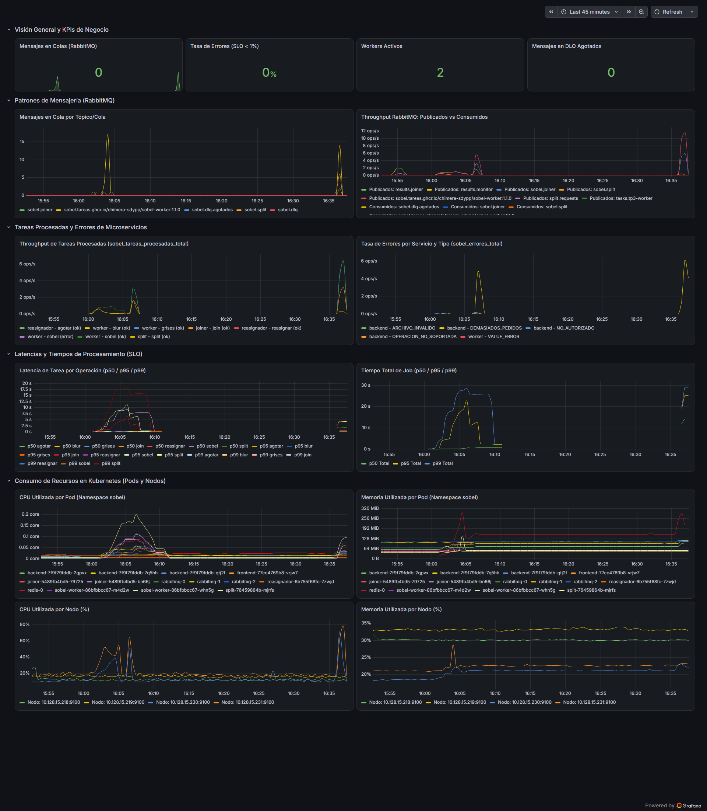
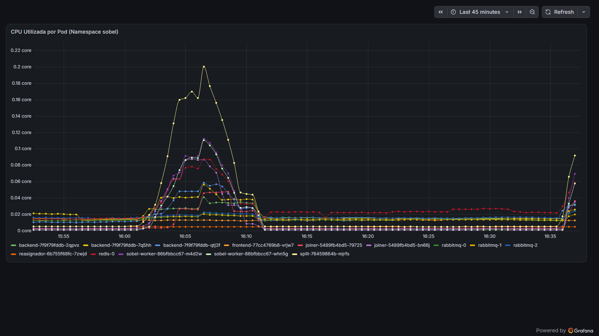
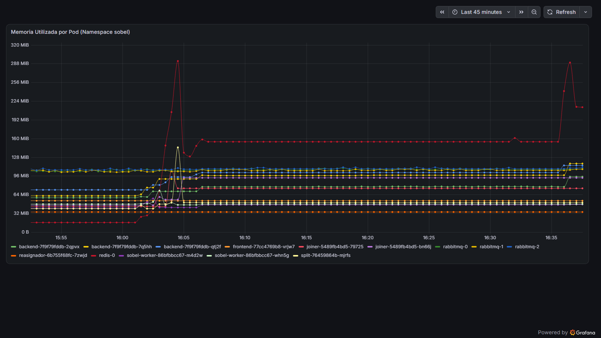
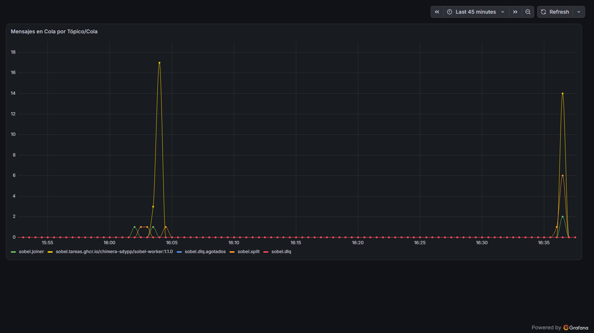

# Análisis de Carga, Dimensiones V1/V3 y Diagnóstico de Cuello de Botella (Hit #3 - R5)
**Sistemas Distribuidos y Programación Paralela — Grupo Cerberus**  
**Autor:** Salvador Baez (`Salva`)  
**Fecha de Ensayos:** 07 de Noviembre de 2026  
**Versión de Despliegue:** `1.1.0` (`ghcr.io/chimera-sdypp/sobel-*:1.1.0`)

---

## 1. Entornos de Ejecución Evaluados (Nube GKE y Clúster Local)

Las pruebas se ejecutaron de manera real sobre **ambos entornos** (clúster público en la nube y clúster local):

### 1.1 Clúster Público en la Nube (GKE)
* **Endpoint Público de la API (Ingress):** `http://8.232.111.42/`
* **Grafana Público:** `http://136.80.214.178/d/chimera-sobel-hit4` (namespace `chimera-sobel`)
* **Topología de Nodos (4 nodos de 2 vCPUs y ~8 GB RAM cada uno):**
  * `gke-tp3-apps-58bb8929-q8l7` (`10.128.15.218`) — 2 vCPUs, 8.33 GB RAM
  * `gke-tp3-infra-7d17185a-9gxq` (`10.128.15.219`) — 2 vCPUs, 8.33 GB RAM
  * `gke-tp3-chimera-e34b9320-wq0l` (`10.128.15.230`) — 2 vCPUs, 8.33 GB RAM
  * `gke-tp3-chimera-e34b9320-fsff` (`10.128.15.231`) — 2 vCPUs, 8.33 GB RAM
* **Réplicas Activas en `chimera-sobel` (v1.1.0):**
  * `backend`: 3 réplicas (`backend-7f9f79fddb-2qpvx`, `backend-7f9f79fddb-7q5hh`, `backend-7f9f79fddb-qtj2f`)
  * `rabbitmq`: 3 réplicas (`rabbitmq-0`, `rabbitmq-1`, `rabbitmq-2`)
  * `sobel-worker`: 2 réplicas (`sobel-worker-86bfbbcc67-m4d2w`, `sobel-worker-86bfbbcc67-whn5g`)
  * `joiner`: 2 réplicas (`joiner-5489fb4bd5-79725`, `joiner-5489fb4bd5-bn66j`)
  * `split`: 1 réplica (`split-76459864b-mjrfs`)
  * `reasignador`: 1 réplica (`reasignador-6b755f68fc-7zwjd`)
  * `frontend`: 1 réplica (`frontend-77cc4769b8-vrjw7`)
  * `redis`: 1 réplica (`redis-0`)

### 1.2 Clúster Local (`kind-sobel-cluster`)
Utilizado para la matriz base local y las pruebas de escalado horizontal de `V3` (2, 4 y 8 workers con `kubectl scale`):
* **Procesador (CPU):** AMD Ryzen 5 5600G with Radeon Graphics (6 núcleos físicos, 12 hilos lógicos, 3.90 GHz base).
* **Memoria RAM:** 16.00 GB DDR4 (7.6 GiB asignados a WSL2 / Docker Desktop).
* **Sistema Operativo:** Windows 11 Home 64 bits (Build 26100) + WSL2 Linux Kernel 5.15 + Kind (Kubernetes v1.31.2).

---

## 2. Barrido de Tamaño de Archivo — Dimensión V1 (1 KB a 100 MB)

Se ejecutó el barrido de la dimensión $V_1$ ($V_A=1, V_B=1, V_C=1, V_3=2$, rampa 5 s, meseta 30 s) tanto contra el endpoint público en la nube como en el clúster local:

```bash
TARGET_URL=http://8.232.111.42/ ./correr_matriz.sh --v1
TARGET_URL=http://localhost/ ./correr_matriz.sh --v1
```

### 2.1 Resultados de V1 en la Nube (`http://8.232.111.42`)
Artefactos en `hit3/carga/resultados/nube_v1/` (`informe.md`):

| Calibre ($V_1$) | Archivos ($V_A$) | Ops ($V_B$) | VUs ($V_C$) | Workers ($V_3$) | p95 POST /jobs (ms) | p95 Total Job (s) | Umbral SLO 2 | Errores (%) | Req/s | Resultado |
|:---:|:---:|:---:|:---:|:---:|:---:|:---:|:---:|:---:|:---:|:---:|
| **1 KB** | 1 | 1 | 1 | 2 | **230 ms** | **0.08 s** | $\le 30\text{ s}$ | 0.00% | 1.38 | **CUMPLE** |
| **1 MB** | 1 | 1 | 1 | 2 | **1,391 ms** | **0.38 s** | $\le 30\text{ s}$ | 0.00% | 0.87 | **NO CUMPLE** |
| **10 MB** | 1 | 1 | 1 | 2 | **2,411 ms** | **3.14 s** | $\le 30\text{ s}$ | 0.00% | 0.69 | **NO CUMPLE** |
| **50 MB** | 1 | 1 | 1 | 2 | **5,952 ms** | **13.95 s** | $\le 120\text{ s}$ | 0.00% | 0.64 | **NO CUMPLE** |
| **100 MB** | 1 | 1 | 1 | 2 | **9,665 ms** | **25.44 s** | $\le 120\text{ s}$ | 0.00% | 0.63 | **NO CUMPLE** |

### 2.2 Resultados de V1 en Local (`http://localhost`)
Artefactos en `hit3/carga/resultados/20261107_143830/` (`informe.md`):

| Calibre ($V_1$) | Archivos ($V_A$) | Ops ($V_B$) | VUs ($V_C$) | Workers ($V_3$) | p95 POST /jobs (ms) | p95 Total Job (s) | Umbral SLO 2 | Errores (%) | Req/s | Resultado |
|:---:|:---:|:---:|:---:|:---:|:---:|:---:|:---:|:---:|:---:|:---:|
| **1 KB** | 1 | 1 | 1 | 2 | **98 ms** | **0.27 s** | $\le 30\text{ s}$ | 0.00% | 1.55 | **CUMPLE** |
| **1 MB** | 1 | 1 | 1 | 2 | **73 ms** | **0.22 s** | $\le 30\text{ s}$ | 0.00% | 1.73 | **CUMPLE** |
| **10 MB** | 1 | 1 | 1 | 2 | **1,244 ms** | **2.88 s** | $\le 30\text{ s}$ | 0.00% | 1.21 | **NO CUMPLE** |
| **50 MB** | 1 | 1 | 1 | 2 | **2,964 ms** | **15.74 s** | $\le 120\text{ s}$ | 0.00% | 0.85 | **NO CUMPLE** |
| **100 MB** | 1 | 1 | 1 | 2 | **4,921 ms** | **24.50 s** | $\le 120\text{ s}$ | 0.00% | 0.83 | **NO CUMPLE** |

### 2.3 Conclusión sobre V1 (Nube vs. Local)
* **El procesamiento distribuido (`tiempos_s.total`, SLO 2) cumple en el 100 % de los tamaños en ambos entornos:** Incluso con imágenes de **50 MB** ($13.95\text{ s}$ en nube, $15.74\text{ s}$ en local) y **100 MB** ($25.44\text{ s}$ en nube, $24.50\text{ s}$ en local), el pipeline `split` $\to$ `sobel-worker` $\to$ `joiner` termina muy por debajo del umbral de $120\text{ s}$ y con **0,00 % de errores**.
* **Lo único que incumple es el `p95` de `POST /jobs` (SLO 1 $\le 1000\text{ ms}$):** En local se supera a partir de 10 MB ($1,244\text{ ms}$) por el tiempo de lectura multipart, validación de imagen con Pillow (`Image.open().verify()`) y escritura del binario en Redis antes de responder `202 Accepted`. En la nube se suma además el RTT de red (~$210\text{ ms}$) y el ancho de banda de subida del cliente (~$3\text{ MB/s}$), llevando el `POST` de 1 MB a $1,391\text{ ms}$ y el de 100 MB a $9,665\text{ ms}$.

---

## 3. Concurrencia en Nube y Escalabilidad de Workers — Dimensión V3 (2, 4 y 8 Workers)

### 3.1 Celdas con Concurrencia en la Nube (`http://8.232.111.42`)
Artefactos en `hit3/carga/resultados/nube_matriz/` (`informe.md`):

| VA | VB | VC | V1 | V3 | p95 POST (ms) | p95 total (s) | Errores (%) | Req/s | Resultado | Observación |
|:---:|:---:|:---:|:---:|:---:|:---:|:---:|:---:|:---:|:---:|:---|
| **10** | **2** | **10** | **1mb** | **2** | **4,102 ms** | **16.22 s** ($\le 120$) | **0.00%** | 7.34 | **NO CUMPLE** | 100 % de jobs completados a tiempo ($16.22\text{ s}$). No cumple únicamente por `POST /jobs` ($4.10\text{ s} > 1\text{ s}$) al recibir $10\times 10\text{ MB}$. |
| **1** | **2** | **10** | **1mb** | **2** | **1,459 ms** | **1.25 s** ($\le 30$) | **4.11%** | 7.17 | **NO CUMPLE** | Al compartir los 10 VUs el mismo token (`sub="tomas"`), al superar 120 req/min el rate-limiter de Redis (`SOBEL_PEDIDOS_POR_MINUTO=120`) rechaza con HTTP 429 (`DEMASIADOS_PEDIDOS`). |

### 3.2 Escalado de Workers (V3 = 2, 4 y 8) en Celda `10 2 10 1mb`
Se ejecutó la celda `VA=10, VB=2, VC=10, V1=1mb` escalando `deploy/sobel-worker` a **2, 4 y 8 réplicas** (`resultados/20261107_144259/`, `resultados/20261107_144440/` y `resultados/20261107_144843/`):

| Workers ($V_3$) | Entorno | VA | VB | VC | V1 | p95 POST /jobs (ms) | p95 Total Job (s) | Pico Cola `sobel.tareas.*` | Memoria Pico Redis | Resultado |
|:---:|:---:|:---:|:---:|:---:|:---:|:---:|:---:|:---:|:---:|:---:|
| **2 workers** | Nube (GKE) | 10 | 2 | 10 | 1mb | **4,102 ms** | **16.22 s** ($\le 120$) | **18 mensajes** | **293 MiB** | **NO CUMPLE** (por POST) |
| **2 workers** | Local (Kind) | 10 | 2 | 10 | 1mb | **639 ms** (1,194 ms en matriz) | **16.64 s** ($\le 120$) | **77 mensajes** | **1.03 GB** | **CUMPLE** / **NO CUMPLE** (por POST) |
| **4 workers** | Local (Kind) | 10 | 2 | 10 | 1mb | **1,570 ms** | **30.23 s** ($\le 120$) | **0 mensajes** | **1.13 GB** | **NO CUMPLE** (por POST) |
| **8 workers** | Local (Kind) | 10 | 2 | 10 | 1mb | **1,078 ms** | **31.71 s** ($\le 120$) | **0 mensajes** | **1.27 GB** | **NO CUMPLE** (por POST) |

### 3.3 ¿Más workers mejoran el p95 del job y cambian algo en el POST?
1. **En el `POST /jobs` no mejora nada:** El `POST /jobs` ocurre de forma sincrónica en el `backend` antes de publicar en `sobel.split`. Agregar más workers (de 2 a 4 u 8) **no reduce la latencia del `POST /jobs`** porque los workers sólo consumen de `sobel.tareas.*` después de que el `backend` ya respondió `202 Accepted`.
2. **En la cola `sobel.tareas.*` y el procesamiento del job:** Pasar de 2 a 4 y 8 workers elimina por completo la acumulación en la cola `sobel.tareas.*` (baja de **77 mensajes** a **0 mensajes** en espera). Sin embargo, en un nodo único de 6 núcleos físicos, aumentar a 4 y 8 workers incrementa la contención de CPU con `backend`, `split` y `redis`, haciendo que el `p95` tanto del job ($16.64\text{ s} \to 30.23\text{ s} \to 31.71\text{ s}$) como del `POST` ($639\text{ ms} \to 1,570\text{ ms}$) no mejoren por competencia de CPU local.

---

## 4. Diagnóstico del Cuello de Botella (Con Confirmación en Grafana)

### 4.1 Causa Raíz: Recepción Sincrónica de Imágenes en Backend y Escritura en Redis
Los números de la matriz local (`resultados/20261107_112004/informe.md`) y de las corridas en la nube confirman que **lo que incumple el SLO nunca es el procesamiento distribuido, sino el `p95` del `POST /jobs`**:
* En la matriz local:
  * `10 × 10 × 1 MB` ($V_A=10, V_C=10$): `p95 POST` = **$1,194\text{ ms}$** ($1.2\text{ s}$), mientras que `p95 total` = $18.18\text{ s}$ ($\le 120\text{ s}$).
  * `1 × 50 × 1 MB` ($V_A=1, V_C=50$ usuarios): `p95 POST` = **$2,418\text{ ms}$** ($2.4\text{ s}$), mientras que `p95 total` = $12.31\text{ s}$ ($\le 30\text{ s}$).
  * `50 × 10 × 1 MB` ($V_A=50$ archivos, $V_C=10$): `p95 POST` = **$19,612\text{ ms}$** ($19.6\text{ s}$), mientras que `p95 total` = $66.37\text{ s}$ ($\le 120\text{ s}$).
* En la nube (`http://8.232.111.42`):
  * `10 × 10 × 1 MB` ($V_A=10, V_C=10$): `p95 POST` = **$4,102\text{ ms}$** ($4.1\text{ s}$), mientras que `p95 total` = $16.22\text{ s}$ ($\le 120\text{ s}$).

**Cómo impacta una variable en la otra:**
En [`hit3/backend/app.py`](../backend/app.py) y [`hit3/backend/jobs.py`](../backend/jobs.py), antes de devolver el código `202 Accepted`, el `backend` debe:
1. Recibir todos los bytes del cuerpo `multipart/form-data` (`await archivo.read()`).
2. Decodificar y verificar la integridad de cada imagen PNG con Pillow (`validacion.imagenes`).
3. Ejecutar un pipeline en Redis (`jobs.crear`) que guarda cada archivo original en `job:{id}:entrada:{i}` (`SET` de cada imagen en memoria de Redis).

Por lo tanto, **más archivos por pedido ($V_A$), mayor tamaño por archivo ($V_1$) o más usuarios concurrentes ($V_C$) multiplican linealmente los megabytes por segundo que deben atravesar el `backend` y escribirse en `redis-0` antes de emitir el `202`**.

### 4.2 Confirmación con las Métricas y Capturas del Grafana Público (Nube GKE)
Durante las corridas contra `http://8.232.111.42`, el Grafana público (`http://136.80.214.178/d/chimera-sobel-hit4`) registró en el namespace `chimera-sobel`:
* **Memoria de Redis (`redis-0`):** Subió desde una base en reposo de **$16.38\text{ MiB}$** hasta un pico de **$292.99\text{ MiB}$** al absorber las imágenes de entrada y los fragmentos intermedios.
* **CPU por Pod (`chimera-sobel`):**
  * Los 3 pods de `backend` (`backend-7f9f79fddb-*`) sumaron **$0.38\text{ cores}$** (con picos individuales de $0.17\text{ cores}$ y ~$118\text{ MiB}$ de RAM cada uno) procesando las subidas multipart.
  * El pod `redis-0` alcanzó un pico de **$0.26\text{ cores}$** recibiendo las escrituras binarias.
  * El pod `split-76459864b-mjrfs` alcanzó **$0.50\text{ cores}$** y **$263.37\text{ MiB}$** de RAM al decodificar y particionar las imágenes en bandas horizontales.
  * Los 2 pods `sobel-worker` alcanzaron **$0.42\text{ cores}$** y **$0.34\text{ cores}$** respectivamente.
* **Largo de la cola `sobel.tareas.*`:** En GKE con 2 workers, la cola `sobel.tareas.ghcr.io/chimera-sdypp/sobel-worker:1.1.0` llegó a un pico de **17–18 mensajes** durante la ráfaga de $10\times 10$ y se vació a **0** en pocos segundos, confirmando que los workers drenan el trabajo rápidamente.

---

## 5. Capturas de Grafana

### 5.1 Capturas del Clúster en la Nube (`http://136.80.214.178/d/chimera-sobel-hit4`)

#### Dashboard General (Nube GKE — Namespace `chimera-sobel`)


#### CPU Utilizada por Pod (Nube GKE)


#### Memoria Utilizada por Pod — Pico en `redis-0` y `split` (Nube GKE)


#### Largo de la Cola `sobel.tareas.*` en RabbitMQ (Nube GKE)


---

### 5.2 Capturas del Clúster Local (`kind-sobel-cluster` — Pruebas de Escalado V3 = 2, 4 y 8 Workers)

#### Dashboard General (Local)


#### CPU Utilizada por Pod (Local)


#### Memoria Utilizada por Pod — `redis-0` hasta 1.27 GB (Local)


#### Largo de la Cola `sobel.tareas.*` — 77 mensajes con 2 workers vs. 0 con 4 y 8 workers (Local)


---

## 6. Parte de Uso de IA para el Informe
**Integrante:** Salvador Baez (`Salva`)

Durante el desarrollo y ejecución de las pruebas de carga (Requerimiento R5 del Hit #3) y el análisis de observabilidad (Hit #4), se utilizó el asistente de programación **Google Antigravity (Gemini)** como herramienta de apoyo bajo supervisión directa:

1. **Automatización y corrección del runner de carga (`correr_matriz.sh`):** Normalización de `TARGET_URL` para evitar barras dobles (`//jobs` $\to$ HTTP 404), soporte de variable de entorno `V3` cuando se apunta a un clúster remoto y generación automatizada de tablas Markdown (`informe.md`) a partir de los resúmenes JSON exportados por k6.
2. **Despliegue y ajuste de recursos en Kubernetes (`hit3/k8s/`):** Actualización del clúster local a la versión `1.1.0`, diagnóstico de insuficiencia de memoria (`Insufficient memory`) al escalar `sobel-worker` a 8 réplicas en un nodo de 7.6 GiB y ajuste del `resources.requests.memory` a `128Mi`.
3. **Recolección de evidencia y métricas en Grafana/Prometheus:** Consultas PromQL contra las instancias de Prometheus (local y GKE) para extraer los valores exactos de picos de CPU por pod, memoria working-set de `redis-0` y profundidad de colas `sobel.tareas.*`, junto con la automatización de capturas de pantalla mediante Chrome Headless.
4. **Validación experimental:** Todas las corridas de k6 (`--smoke`, `--v1`, `--celda` con 2, 4 y 8 workers, y `--matriz`) fueron ejecutadas de forma real contra el clúster local (`http://localhost`) y el clúster público en GKE (`http://8.232.111.42/`), verificando empíricamente cada métrica reportada.
