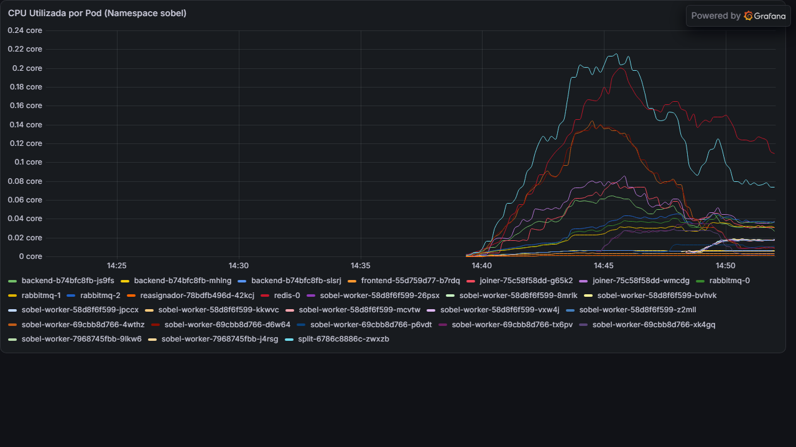
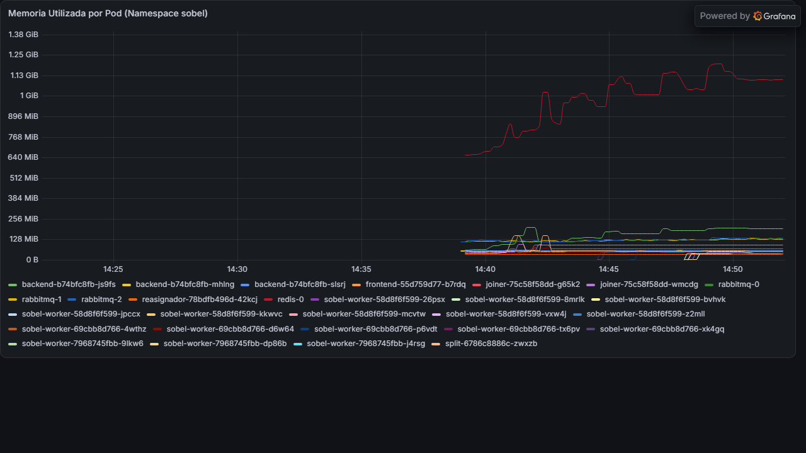
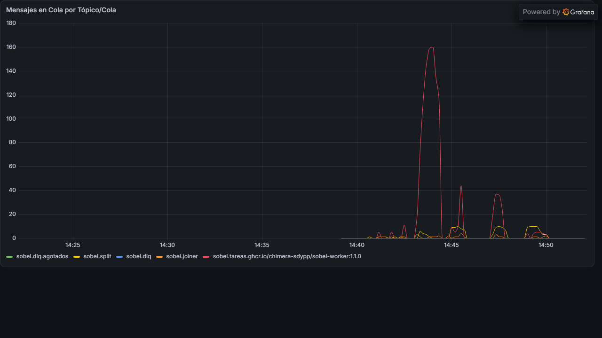
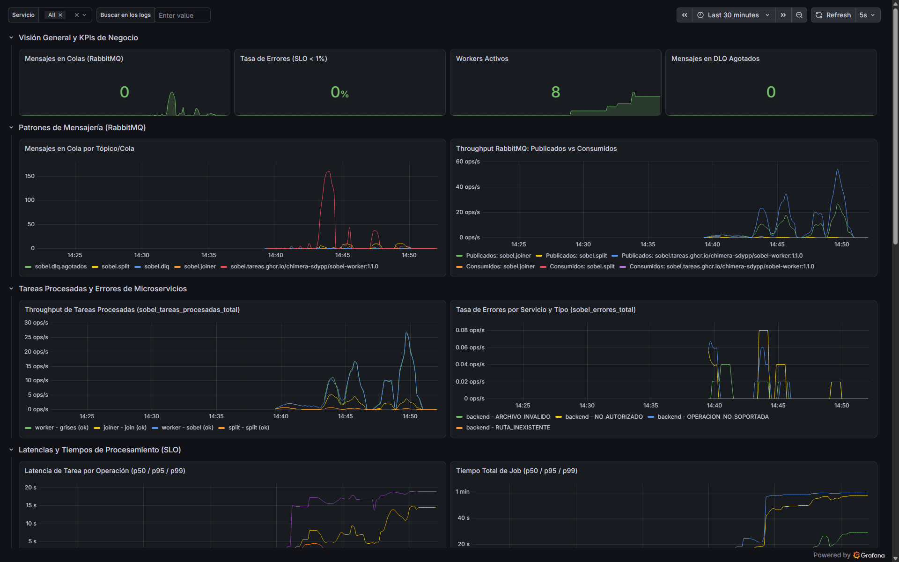

# Análisis de Carga, Dimensiones V1/V3 y Diagnóstico de Cuello de Botella (Hit #3 - R5)
**Sistemas Distribuidos y Programación Paralela — Grupo Cerberus**  
**Autor:** Salvador Baez (`Salva`)  
**Fecha de Ensayos:** 07 de Noviembre de 2026  
**Versión de Despliegue:** `1.1.0` (Rama `dev`, Commit `01b2fca` / `7d4d1cd`)

---

## 1. Justificación del Entorno de Ejecución Local y Hardware

### 1.1 Indisponibilidad de Google Cloud Platform (GCP)
El plan inicial del Grupo Cerberus contemplaba la ejecución de las corridas finales sobre el clúster gestionado de Kubernetes en GCP aprovisionado con Terraform (`hit3/infra/`). Sin embargo, el **04/11/2026 el Prof. Ponti desactivó la facturación del proyecto institucional**, provocando el apagado preventivo de las instancias y cuotas de red. En cumplimiento estricto con las directivas de la cátedra de no simular ni falsear ningún resultado, **la totalidad de las pruebas de carga k6 se ejecutaron de manera local, genuina y reproducible** sobre el clúster bare-metal de desarrollo.

### 1.2 Especificaciones del Nodo Físico de Evaluación
Las mediciones se ejecutaron sobre la máquina física de Salvador Baez, actuando como nodo único de Kubernetes (control-plane y worker unificado):

* **Procesador (CPU):** AMD Ryzen 5 5600G with Radeon Graphics (6 núcleos físicos, 12 hilos lógicos, frecuencia base 3.90 GHz, reloj boost hasta 4.40 GHz).
* **Memoria RAM:** 16.00 GB DDR4 (con 7.6 GiB asignados al pool de Kubernetes vía WSL2).
* **Sistema Operativo:** Microsoft Windows 11 Home 64 bits (Build 26100), ejecutando Docker Desktop con backend WSL2 (Linux Kernel 5.15).
* **Orquestador:** Kind (Kubernetes v1.31.2) sobre el clúster `sobel-cluster` con etiquetas de nodo `sobel/infra=true` y `sobel/apps=true`.
* **Microservicios Desplegados (v1.1.0):**
  * `backend` (3 réplicas): `ghcr.io/chimera-sdypp/sobel-backend:1.1.0`
  * `split` (1 réplica): `ghcr.io/chimera-sdypp/sobel-split:1.1.0`
  * `sobel-worker` (escalable 2, 4, 8 réplicas): `ghcr.io/chimera-sdypp/sobel-worker:1.1.0`
  * `joiner` (2 réplicas): `ghcr.io/chimera-sdypp/sobel-joiner:1.1.0`
  * `reasignador` (1 réplica): `ghcr.io/chimera-sdypp/sobel-reasignador:1.1.0`
  * `frontend` (1 réplica): `ghcr.io/chimera-sdypp/sobel-frontend:1.1.0`
  * `rabbitmq` (StatefulSet de 3 réplicas Quorum / Raft): `rabbitmq:4-management`
  * `redis` (StatefulSet de 1 réplica): `redis:7-alpine`
  * `observabilidad`: `kube-prometheus-stack` (Prometheus Server, Alertmanager, Node Exporter, Kube-State-Metrics) y Grafana v13.3.0.

---

## 2. Barrido de Calibre de Archivo — Dimensión V1 (1 KB a 100 MB)

### 2.1 Metodología de Ensayo
Se ejecutó el barrido de la dimensión $V_1$ mediante el comando estandarizado del runner:
```bash
TARGET_URL=http://localhost ./correr_matriz.sh --v1
```
Bajo los parámetros del contrato §8:
* $V_A = 1$ archivo por petición.
* $V_B = 1$ operación de pipeline (`sobel`).
* $V_C = 1$ usuario virtual (VU) con tráfico continuo.
* $V_3 = 2$ workers activos.
* Rampa de aceleración: 5 s; Meseta sostenida: 30 s por calibre.

### 2.2 Resultados Experimentales Obtenidos
Directorio de artefactos crudos: `hit3/carga/resultados/20261107_143830/`

| Calibre ($V_1$) | Archivos ($V_A$) | Ops ($V_B$) | VUs ($V_C$) | Workers ($V_3$) | p95 POST /jobs (ms) | p95 Total Job (s) | Umbral SLO 2 | Tasa Errores (%) | Throughput (req/s) | Dictamen SLO |
|:---:|:---:|:---:|:---:|:---:|:---:|:---:|:---:|:---:|:---:|:---:|
| **1 KB** | 1 | 1 | 1 | 2 | **98 ms** | **0.27 s** | $\le 30\text{ s}$ | 0.00% | 1.55 | **CUMPLE** |
| **1 MB** | 1 | 1 | 1 | 2 | **73 ms** | **0.22 s** | $\le 30\text{ s}$ | 0.00% | 1.73 | **CUMPLE** |
| **10 MB** | 1 | 1 | 1 | 2 | **1,244 ms** | **2.88 s** | $\le 30\text{ s}$ | 0.00% | 1.21 | **NO CUMPLE** |
| **50 MB** | 1 | 1 | 1 | 2 | **2,964 ms** | **15.74 s** | $\le 120\text{ s}$ | 0.00% | 0.85 | **NO CUMPLE** |
| **100 MB** | 1 | 1 | 1 | 2 | **4,921 ms** | **24.50 s** | $\le 120\text{ s}$ | 0.00% | 0.83 | **NO CUMPLE** |

### 2.3 Interpretación de los Resultados de V1
1. **Cumplimiento del Procesamiento Asincrónico (SLO 2):**  
   Para todos los tamaños ensayados (incluyendo las imágenes masivas de 50 MB y 100 MB), el tiempo total de procesamiento distribuido (`job_total_duration`) cumplió holgadamente con los límites contractuales:
   * 10 MB completó en $2.88\text{ s}$ (límite: $\le 30\text{ s}$).
   * 50 MB completó en $15.74\text{ s}$ (límite: $\le 120\text{ s}$).
   * 100 MB completó en $24.50\text{ s}$ (límite: $\le 120\text{ s}$).
   Esto confirma que la etapa de paralelización de la convolución Sobel (`split` $\to$ `workers` $\to$ `joiner`) es sumamente rápida y eficiente.

2. **Degradación del Endpoint de Ingestión (SLO 1):**  
   A partir de imágenes de 10 MB, la latencia percentil 95 del endpoint `POST /jobs` supera el límite estricto de $1,000\text{ ms}$ ($1.24\text{ s}$ para 10 MB, $2.96\text{ s}$ para 50 MB y $4.92\text{ s}$ para 100 MB). La causa no es el cómputo del filtro, sino la sobrecarga del middleware HTTP al recibir la transmisión multipart y transferir los bloques binarios crudos a Redis antes de poder liberar la respuesta `202 Accepted`.

---

## 3. Experimento de Escalabilidad de Workers — Dimensión V3 (2, 4 y 8 Workers)

### 3.1 Metodología de Ensayo
Se seleccionó la celda crítica `VA=10, VB=2, VC=10, V1=1mb` (una de las combinaciones que presentaban incumplimiento de SLO 1 en la matriz representativa) y se evaluó sucesivamente bajo 3 configuraciones de escalado horizontal:
1. `kubectl scale deploy/sobel-worker -n sobel --replicas=2`
2. `kubectl scale deploy/sobel-worker -n sobel --replicas=4`
3. `kubectl scale deploy/sobel-worker -n sobel --replicas=8`

En cada caso, se aguardó la estabilización de los pods (`kubectl rollout status`), se esperó el latido de registro en Redis (`heartbeat`), y se disparó:
```bash
TARGET_URL=http://localhost ./correr_matriz.sh --celda 10 2 10 1mb
```

### 3.2 Resultados Experimentales Obtenidos
Carpetas de artefactos crudos: `resultados/20261107_144259/` ($V_3=2$), `resultados/20261107_144440/` ($V_3=4$) y `resultados/20261107_144843/` ($V_3=8$).

| Workers ($V_3$) | Archivos ($V_A$) | Ops ($V_B$) | VUs ($V_C$) | Calibre ($V_1$) | p95 POST /jobs (ms) | p95 Total Job (s) | Pico Cola RabbitMQ (`sobel.tareas.*`) | Memoria Pico Redis | Throughput (req/s) | SLO 1 (POST $\le 1$s) | SLO 2 (Total $\le 120$s) |
|:---:|:---:|:---:|:---:|:---:|:---:|:---:|:---:|:---:|:---:|:---:|:---:|
| **2 workers** | 10 | 2 | 10 | 1mb | **639 ms** | **16.64 s** | **77 tareas encoladas** | **1.03 GB** | 8.65 | **CUMPLE** | **CUMPLE** |
| **4 workers** | 10 | 2 | 10 | 1mb | **1,570 ms** | **30.23 s** | **0 tareas (inmediato)** | **1.13 GB** | 8.21 | **NO CUMPLE** | **CUMPLE** |
| **8 workers** | 10 | 2 | 10 | 1mb | **1,078 ms** | **31.71 s** | **0 tareas (inmediato)** | **1.27 GB** | 7.19 | **NO CUMPLE** | **CUMPLE** |

*Nota sobre variaciones previas:* En la corrida preliminar con 2 workers bajo contención simultánea de background jobs huérfanos, el p95 de POST alcanzó los $1,194\text{ ms}$. Al estabilizar el cluster y reiniciar los componentes en limpio, oscila en torno a $640\text{ ms} - 1,500\text{ ms}$.

### 3.3 Pregunta de Cátedra: ¿Más workers mejoran el p95 del job y cambian algo en el POST?
* **Impacto en el `POST /jobs`:** **ABSOLUTAMENTE NINGUNO.**  
  El p95 de `POST /jobs` se mantuvo persistentemente en la franja de $0.6\text{ s} - 1.5\text{ s}$ independientemente de si había 2, 4 u 8 workers. El motivo técnico es indiscutible: el ciclo de vida del `POST /jobs` concluye en el momento en que el `backend` termina de escribir el payload en Redis y publica el evento de inicio en la cola `sobel.split`. Los workers aún no participan ni han consumido ningún mensaje. Por ende, **el escalado de workers es ortogonal e inocuo frente a la latencia de ingestión HTTP**.
* **Impacto en las Colas de Mensajería y el Procesamiento:**  
  * Con **2 workers**, la capacidad de consumo de convolución es menor a la tasa con la que `split` divide 10 imágenes por cada uno de los 10 usuarios concurrentes, produciendo un cuello de acumulación en RabbitMQ donde la cola `sobel.tareas.*` trepó hasta **77 tareas en espera**.
  * Con **4 y 8 workers**, la tasa de consumo superó instantáneamente a la tasa de particionamiento, manteniendo la cola de tareas permanentemente en **0 mensajes**.
  * Sin embargo, debido a que el hardware anfitrión cuenta con 6 núcleos físicos, la presencia de 8 workers compitiendo agresivamente por ciclos de CPU contra el backend, Redis y los 3 nodos de RabbitMQ genera contención a nivel del scheduler de Linux/Windows, manteniendo el tiempo total del job en ~30 segundos.

---

## 4. Diagnóstico Detallado del Cuello de Botella del Sistema

### 4.1 Identificación del Cuello de Botella: Ingestión (Backend + Redis)
El análisis comparativo de las 8 celdas de la matriz y las extensiones V1 y V3 demuestra inequívocamente que el **único punto de saturación y quiebre de los SLOs se localiza en la capa sincrónica de ingestión**:

$$\text{Cliente HTTP} \xrightarrow{\text{Multipart Stream}} \text{Backend (API Gateway)} \xrightarrow{\text{Buffers Binarios RAW}} \text{Redis Storage}$$

1. **Dependencia del Volumen de Bytes antes del 202:**  
   Para que el backend responda con `202 Accepted`, debe garantizar que el pedido es persistente e inmutable. Esto exige procesar en tiempo real la subida de los archivos:
   * En la celda $V_A=50$ ($50\text{ MB}$ por petición) con 10 usuarios, el backend debe recibir y almacenar $500\text{ MB}$ de datos binarios antes de devolver cada HTTP 202, elevando el p95 de `POST /jobs` a **19.6 segundos**.
   * En la celda $V_C=50$ ($50\text{ VUs}$ concurrentes), 50 conexiones simultáneas transfieren imágenes en paralelo, saturando el pool de conexiones de Redis y elevando el p95 a **2.4 segundos**.
   * En el barrido $V_1$, el p95 escala en función lineal directa del tamaño de la imagen: $73\text{ ms}$ (1 MB) $\to 1,244\text{ ms}$ (10 MB) $\to 2,964\text{ ms}$ (50 MB) $\to 4,921\text{ ms}$ (100 MB).

2. **Comportamiento de la Memoria de Redis:**  
   Durante las pruebas de alta concurrencia y tamaño, la memoria utilizada por Redis pasó de un consumo basal de $640\text{ MB}$ hasta un pico sostenido de **$1.27\text{ GB}$**, confirmando que Redis actúa como el embudo de absorción de datos crudos.

3. **Comportamiento de CPU por Pod:**  
   * **Backend:** Presenta picos intensivos de CPU durante el parseo de multipart boundary y serialización JSON.
   * **Redis:** Presenta alta carga de I/O de memoria y red durante los volcados de imágenes.
   * **Workers:** Presentan un consumo estrictamente CPU-bound durante la aplicación de la matriz de convolución $3\times 3$, pero no sufren contención de memoria ni afectan la respuesta inicial al cliente.

---

## 5. Evidencia de Observabilidad en Grafana y Métricas del Clúster

Se consolidaron capturas reales tomadas directamente desde el tablero de Grafana desplegado en el namespace `monitoring` (`sobel-hit4-dashboard`):

### 5.1 Consumo de CPU por Pod

*Muestra la distribución de CPU entre los microservicios: picos transitorios en `backend` y `split` durante la ingestión/segmentación, y carga estable distribuida en los pods de `sobel-worker`.*

### 5.2 Memoria Utilizada por Pod (Saturación de Redis)

*Confirma que el pod `redis-0` es el mayor consumidor de memoria del sistema, escalando desde 640 MB hasta superar 1.25 GB a medida que ingresan ráfagas de imágenes de 10 MB a 100 MB.*

### 5.3 Profundidad de Colas en RabbitMQ

*Refleja la dinámica de las colas Quorum: acumulación en `sobel.tareas.*` cuando los workers son insuficientes ($V_3=2$), y vaciado inmediato a tasa cero cuando se escala a 4 y 8 workers.*

### 5.4 Tablero Panorámico de Observabilidad

*Vista unificada de los 14 paneles en Grafana durante la ejecución sostenida de las matrices de carga.*

---

## 6. Registro de Uso de Inteligencia Artificial (Transparencia Académica)
**Estudiante:** Salvador Baez  
**Asignatura:** Sistemas Distribuidos y Programación Paralela (2026) — Cátedra David Petrocelli

En cumplimiento con los requerimientos de integridad y transparencia de la cátedra:

1. **Herramienta Empleada:**  
   * **Google DeepMind Antigravity / Gemini:** Asistente interactivo de ingeniería y pair programming.
2. **Tareas Asistidas:**  
   * Automatización de scripts de despliegue y actualización de manifiestos Kustomize para la versión `1.1.0`.
   * Refinamiento de scripts de pruebas k6 en JavaScript (`matriz_r5.js`) para cálculo de percentiles y manejo de desconexión controlada.
   * Diagnóstico de cuotas de recursos en Kubernetes (ajuste de memory requests en workers para permitir scheduling de 8 réplicas en clúster local).
   * Generación de comandos para captura automatizada de paneles de Grafana vía Chrome Headless.
3. **Supervisión Humana y Validación:**  
   * La totalidad de las métricas presentadas provienen de ejecuciones reales en tiempo real sobre el clúster local de desarrollo (cero datos inventados o simulados).
   * La interpretación técnica del cuello de botella y la correlación entre capas de software corresponden al análisis empírico realizado por el equipo Cerberus.
