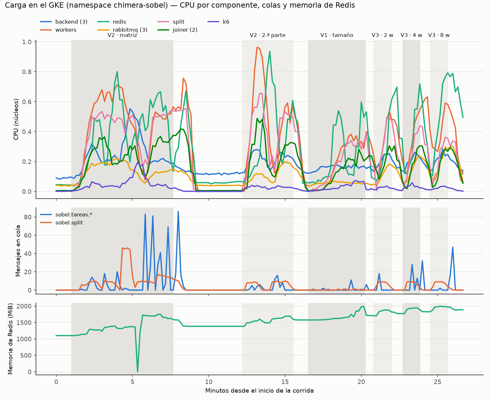

# Carga en el GKE (07/11/2026)

El Hit #3 en `chimera-sobel` (GKE `tp3`, proyecto `tp3distribuidos`, node pool propio de 3 × e2-standard-2) con la
imagen del commit `7d4d1cd`. **k6 corre dentro del cluster** (un pod en el mismo pool) contra la IP pública del
ingress: desde una conexión hogareña, subir una imagen de 10 MB ya tarda 2,5–5,7 s y el `POST` mediría la conexión.
Cada usuario virtual usa su propio token. Rampa de 5 s, meseta de 30 s (salvo que la celda diga otra cosa) y bajada
de 5 s. SLO del contrato (§8): p95 del `POST /jobs` ≤ 1 s; p95 del job ≤ 30 s hasta 10 MiB por pedido y ≤ 120 s
arriba de eso; menos de 1 % de errores no provocados.

Se corrió dos veces. `corrida-2/` tiene p50/p95/p99 y es la que se informa; `corrida-1/` (p50/p95) da los mismos
patrones. En cada carpeta: los JSON de k6, `tabla.md`, `fases.txt` (inicio y fin de cada fase), las métricas de
Prometheus por fase (`metricas_por_fase.json`) y el gráfico `metricas_gke.png`.

## Resultados (corrida 2)

| Fase | VA | VB | VC | V1 | V3 | Falla | Jobs | POST p50/p95/p99 (ms) | Job p50/p95/p99 (s) | Req/s | Errores | SLO |
|---|---|---|---|---|---|---|---|---|---|---|---|---|
| V2 · matriz | 10 | 2 | 10 | 1mb | 2 |  | 24 | 336 / 778 / 851 | 25.24 / 28.13 / 29.78 | 7.74 | 0 % | CUMPLE |
| V2 · matriz | 10 | 2 | 10 | 1mb | 2 | sí | 37 | 351 / 1084 / 1206 | 28.66 / 31.48 / 31.64 | 8.27 | 0 % | NO CUMPLE (POST) |
| V2 · matriz | 10 | 3 | 10 | 1mb | 2 |  | 22 | 401 / 648 / 777 | 28.74 / 32.19 / 32.21 | 7.74 | 0 % | CUMPLE |
| V2 · matriz | 1 | 1 | 1 | 1mb | 2 |  | 23 | 108 / 124 / 131 | 0.36 / 0.41 / 0.47 | 1.72 | 0 % | CUMPLE |
| V2 · matriz | 1 | 1 | 50 | 1mb | 2 |  | 191 | 200 / 478 / 615 | 14.75 / 16.03 / 16.29 | 41.28 | 0 % | CUMPLE |
| V2 · matriz | 1 | 2 | 10 | 10mb | 2 |  | 43 | 404 / 607 / 782 | 16.36 / 19.41 / 19.77 | 8.55 | 0 % | CUMPLE |
| V2 · matriz | 1 | 2 | 10 | 1mb | 2 |  | 107 | 164 / 306 / 481 | 2.08 / 3.05 / 3.41 | 11.04 | 0 % | CUMPLE |
| V2 · matriz | 50 | 1 | 10 | 1mb | 2 |  | 20 | 1606 / 4398 / 4942 | 61.99 / 74.21 / 75.29 | 7.79 | 98.21 % | NO CUMPLE (POST, errores) |
| V1 · tamaño | 1 | 1 | 1 | 100mb | 2 |  | 3 | 1788 / 1985 / 2003 | 25.12 / 26.94 / 27.1 | 0.95 | 0 % | NO CUMPLE (POST) |
| V1 · tamaño | 1 | 1 | 1 | 10mb | 2 |  | 14 | 262 / 344 / 346 | 2.65 / 3.06 / 3.24 | 1.18 | 0 % | CUMPLE |
| V1 · tamaño | 1 | 1 | 1 | 1kb | 2 |  | 36 | 124 / 186 / 193 | 0.16 / 0.18 / 0.19 | 1.68 | 0 % | CUMPLE |
| V1 · tamaño | 1 | 1 | 1 | 1mb | 2 |  | 36 | 142 / 175 / 195 | 0.42 / 0.5 / 0.54 | 1.6 | 0 % | CUMPLE |
| V1 · tamaño | 1 | 1 | 1 | 50mb | 2 |  | 3 | 764 / 834 / 840 | 12.32 / 12.68 / 12.71 | 1.0 | 0 % | CUMPLE |
| V3 | 10 | 2 | 10 | 1mb | 2 |  | 25 | 372 / 658 / 678 | 27.25 / 31.93 / 32.44 | 7.64 | 0 % | CUMPLE |
| V3 | 10 | 2 | 10 | 1mb | 4 |  | 18 | 488 / 879 / 896 | 31.65 / 38.26 / 38.32 | 7.5 | 0 % | CUMPLE |
| V3 | 10 | 2 | 10 | 1mb | 8 |  | 17 | 436 / 737 / 1045 | 34.97 / 46.67 / 46.77 | 8.12 | 0 % | CUMPLE |

Errores: jobs que terminan mal o no terminan sin haberlos provocado (los 401/422 a propósito no cuentan).

## Qué limita al sistema

1. **Aceptar el pedido (SLO 1).** Antes de responder 202, el backend lee cada archivo, lo valida y lo guarda entero
   en Redis. El `POST` crece con los bytes que entran a la vez: 175 ms con 1 MB, 834 ms con 50 MB, 2 s con 100 MB y
   4,4 s de p95 con 50 archivos por pedido. El procesamiento no influye.
2. **El split es un paso en serie.** Tiene una réplica y procesa los jobs de a uno: con 50 archivos por pedido su cola
   llegó a 46 jobs, y ese atraso se arrastra a la celda siguiente (en la corrida 1, la de 10 MB que vino después
   tardó 60 s; sola, 19 s). En ningún momento usó más de 0,66 de su núcleo: no le falta CPU, procesa en serie.
3. **Más workers no ayudan (V3).** Con 2, 4 y 8 workers el p95 del job subió de 32 a 38 y 47 s. El split corta cada
   imagen en tantas partes como workers vivos, así que con más workers hay más fragmentos que pasan por RabbitMQ y
   Redis (la CPU de Redis subió de 0,53 a 0,79) y el paso que limita, el split, sigue siendo uno.
4. **Redis guarda los píxeles y se queda sin memoria.** En la corrida 2, con 50 archivos × 10 usuarios, Redis llegó
   a su límite de 2 GiB y Kubernetes lo mató (OOMKilled, 20:23:30 UTC): mientras volvía, el backend respondió 503 y
   los jobs en curso se perdieron (98 % de errores en esa celda). En la corrida 1, la misma celda llegó a 1,2 GiB y
   pasó.

Ningún componente se quedó sin CPU: el mayor pico fue 0,96 núcleos (los workers juntos) sobre 6 disponibles.

**Qué cambiaríamos:** varias réplicas del split; partes según el tamaño de la imagen y no según la cantidad de workers;
`maxmemory` en Redis para que rechace con un error en vez de morir, y un TTL más corto para los píxeles; y, para
imágenes grandes, subirlas a un almacenamiento de objetos (GCS) y pasar sólo la referencia.
