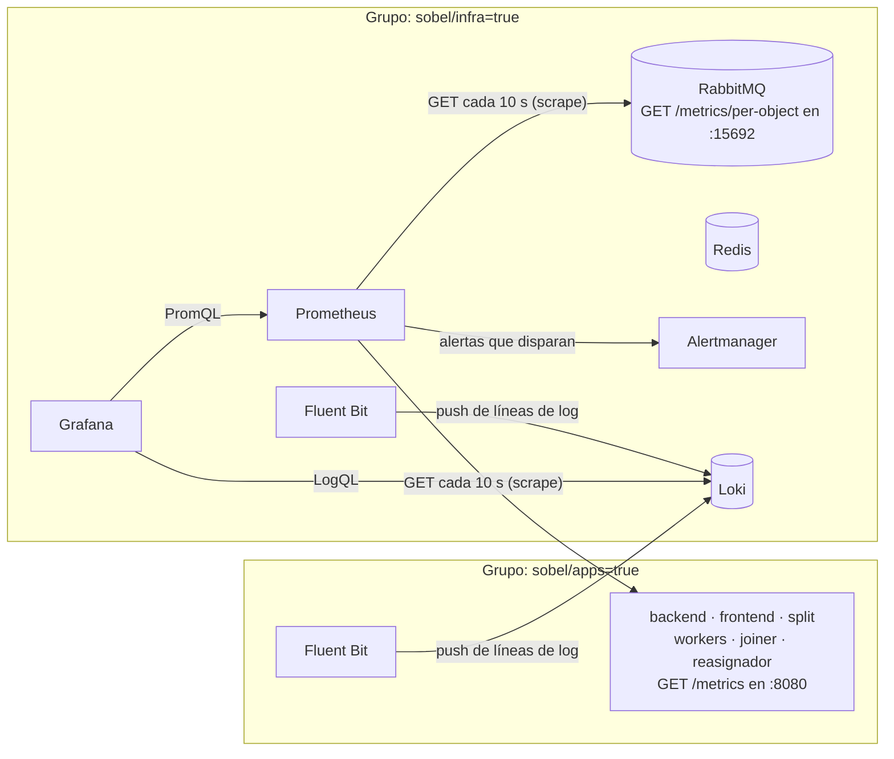
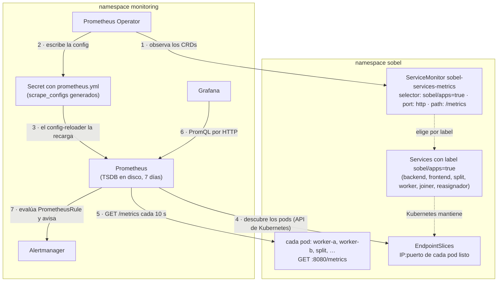
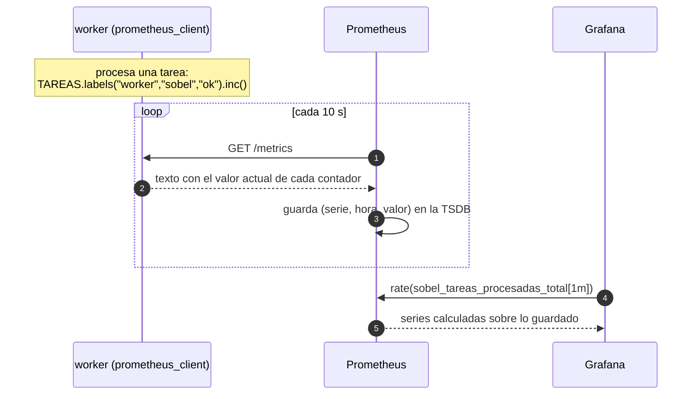
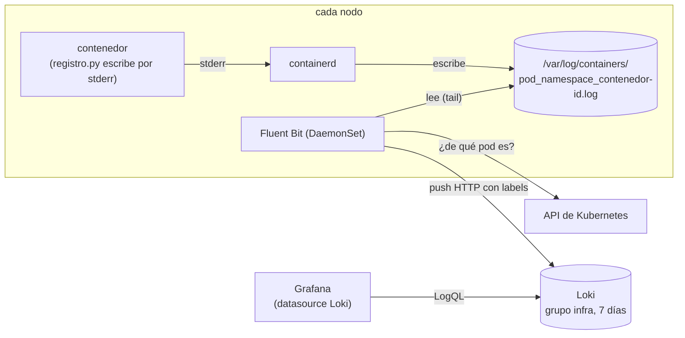

# Hit #4 — Observabilidad (Prometheus, Grafana, Alertas y Logs)

Este módulo implementa el stack integral de observabilidad para la arquitectura distribuida del **Hit #3**, utilizando **Prometheus**, **Grafana**, **Alertmanager** y **ServiceMonitors** mediante `kube-prometheus-stack` (Helm), y **Loki** con **Fluent Bit** para juntar los logs de todos los pods.

---

## 1. Arquitectura y Segmentación de Recursos

Siguiendo las decisiones del proyecto, todo el stack de observabilidad corre en el grupo de nodos de infraestructura (**`sobel/infra=true`**) mediante `nodeSelector` y `tolerations` configurados en [`values.yaml`](values.yaml):



Las flechas van en el sentido en que viaja el pedido: Prometheus **va a buscar** las métricas (sección 2) y Fluent
Bit **empuja** los logs (sección 3). Fluent Bit es un DaemonSet: hay uno en cada nodo de los dos grupos.

* **Aislamiento de Carga:** El scraping y procesamiento de métricas no consume memoria ni ciclos de CPU en los nodos donde se realiza el procesamiento intensivo de imágenes (`sobel/apps=true`).
* **En k3s local:** Para que un único nodo corra ambos grupos sin quedar en `Pending`, se aplican ambas etiquetas simultáneamente:
  ```bash
  kubectl label nodes $(kubectl get nodes -o jsonpath='{.items[0].metadata.name}') sobel/infra=true sobel/apps=true --overwrite
  ```

---

## 2. Cómo llegan las métricas a Prometheus

### 2.1 Nadie le manda nada a Prometheus: él las va a buscar (modelo *pull*)

Ningún servicio conoce a Prometheus ni le envía datos. Cada uno lleva sus contadores en memoria con la biblioteca
`prometheus_client` (`hit3/comun/metricas.py`: `TAREAS.labels(...).inc()`, `TIEMPO_TAREA.observe(...)`) y los
**expone** como texto en `GET /metrics`, en el mismo puerto que `/health` (`hit3/comun/salud.py`). Ése es el "puerto
abierto": un endpoint HTTP que cualquiera puede leer.

```text
$ kubectl port-forward deploy/sobel-worker 8080 -n sobel &
$ curl -s localhost:8080/metrics | grep sobel_tareas_procesadas
sobel_tareas_procesadas_total{operacion="sobel",resultado="ok",servicio="worker"} 42.0
sobel_tareas_procesadas_total{operacion="blur",resultado="error",servicio="worker"} 3.0
```

El truco está en cómo sabe Prometheus **a quién** pedírselo. En un clúster los pods nacen, mueren y cambian de IP,
así que no hay una lista fija: la arma el **Prometheus Operator** a partir de los `ServiceMonitor`.



1. El **operador** (lo instaló el chart) observa los recursos `ServiceMonitor` de cualquier namespace
   (`serviceMonitorSelector: {}` en [`values.yaml`](values.yaml)).
2. Por cada uno genera un bloque `scrape_config` con *service discovery* de Kubernetes: "los Services de `sobel`
   con label `sobel/apps=true`, el puerto que se llama `http`, la ruta `/metrics`". Lo guarda en un Secret.
3. Un sidecar de Prometheus (`config-reloader`) ve el cambio y le pide a Prometheus que recargue la configuración.
4. Prometheus le pregunta a la API de Kubernetes por los **endpoints** de esos Services: la IP de **cada pod**
   listo, no la IP del Service. Si el worker tiene 2 réplicas, son 2 targets; si escala a 5, aparecen solos.
5. Cada 10 s (`scrapeInterval`) les hace `GET /metrics` a todos (*scrape*), les agrega los labels `pod`,
   `namespace`, `service`, `job` e `instance`, y guarda cada valor con su hora en su base de series de tiempo.
   Un target que no responde queda con `up == 0`.
6. **Grafana no junta nada**: cada panel es una consulta PromQL a la API HTTP de Prometheus, que responde con las
   series ya guardadas.
7. Prometheus también evalúa las reglas de [`alertrules.yaml`](alertrules.yaml) cada 10 s; cuando una se cumple el
   tiempo de su `for`, le **manda** la alerta a Alertmanager, que es el que avisa.

Los targets se pueden ver en vivo en Prometheus, en **Status → Targets**
(`http://localhost:9090/targets`, con el port-forward de la sección 7).



Los contadores sólo suben: Prometheus guarda el valor en cada scrape y `rate()` calcula cuánto creció por segundo.
Por eso no importa si un pod se reinicia (el contador vuelve a 0 y `rate()` lo detecta como reinicio).

### 2.2 Las métricas que no salen de nuestro código

| Qué | De dónde | Cómo lo lee Prometheus |
|---|---|---|
| Colas de RabbitMQ (mensajes, publicados, entregados) | plugin `rabbitmq_prometheus` del broker | ServiceMonitor `rabbitmq-metrics` → `GET :15692/metrics/per-object` |
| CPU y memoria de cada contenedor (`container_cpu_usage_seconds_total`, `container_memory_working_set_bytes`) | **cAdvisor**, que viene dentro del kubelet de cada nodo | ServiceMonitor del kubelet que crea el chart → `GET :10250/metrics/cadvisor` |
| Estado de los objetos (réplicas disponibles de un Deployment, pods `Running`) | **kube-state-metrics**: lee la API de Kubernetes y lo traduce a métricas | ServiceMonitor del chart → `GET /metrics` |
| CPU, memoria y disco de la máquina | **node-exporter**: un DaemonSet, un pod por nodo | ServiceMonitor del chart → `GET :9100/metrics` |

Redis no tiene exporter: el estado de los jobs se ve por el backend (`sobel_tareas_en_cola`) y el joiner.

### 2.3 Qué hizo la instalación

[`instalar_observabilidad.sh`](instalar_observabilidad.sh) corre `helm upgrade --install` del chart
`prometheus-community/kube-prometheus-stack` con [`values.yaml`](values.yaml). Un chart de Helm es un paquete de
manifiestos de Kubernetes con variables; el `values.yaml` las completa. Este chart instala:

- Los **CRDs** `Prometheus`, `Alertmanager`, `ServiceMonitor`, `PodMonitor` y `PrometheusRule`: tipos nuevos de
  recurso que la API de Kubernetes no trae.
- El **Prometheus Operator**, el que convierte esos recursos en configuración (pasos 1 a 3 de arriba).
- **Prometheus** (StatefulSet) y **Alertmanager** (StatefulSet), creados por el operador a partir de sus CRDs.
- **Grafana**, con Prometheus ya cargado como datasource y un sidecar que levanta los dashboards de los ConfigMaps con
  label `grafana_dashboard: "1"` (así entra el nuestro).
- **kube-state-metrics** y **node-exporter**, con sus ServiceMonitors, y el ServiceMonitor del kubelet (cAdvisor).
- Reglas y dashboards por defecto del clúster (`defaultRules`).

Lo nuestro se aplica aparte, con `kubectl apply`: los dos ServiceMonitors, las alertas (`PrometheusRule`) y el
dashboard.

---

## 3. Logs de todos los pods (Loki y Fluent Bit)

Con 50 réplicas, `kubectl logs` de a un pod no sirve. Las métricas dicen **cuánto** pasa; los logs dicen **qué** le
pasó a una tarea en particular. Para tenerlos en un solo lugar:



- Los servicios no cambian: `hit3/comun/registro.py` ya escribe cada línea por stderr, y el runtime de contenedores
  la guarda en el disco del nodo (es lo que lee `kubectl logs`).
- **Fluent Bit** ([`values-fluent-bit.yaml`](values-fluent-bit.yaml)) corre en todos los nodos, también los del
  grupo apps (tolera cualquier taint). Lee esos archivos, le pregunta a la API de Kubernetes a qué pod corresponde
  cada uno y le **manda** las líneas a Loki con los labels `namespace`, `pod`, `contenedor`, `app` (el
  `app.kubernetes.io/name` del pod) y `nivel` (`INFO`, `WARNING`, `ERROR`, sacado del formato
  `fecha | NIVEL | mensaje` de `registro.py`; las líneas de RabbitMQ y Redis no lo tienen).
- **Loki** ([`values-loki.yaml`](values-loki.yaml)) guarda las líneas comprimidas e indexa sólo los labels, no el
  texto: por eso es más liviano que Elasticsearch. Corre en un solo pod (`SingleBinary`) en el grupo infra, con 5 GiB
  de disco y 7 días de retención, como Prometheus.
- **Grafana** lo tiene como datasource (`additionalDataSources` en [`values.yaml`](values.yaml)).

Al revés que las métricas, los logs se **empujan**: un log es un evento que pasa una vez, no un valor que se pueda
volver a leer más tarde.

En el dashboard, la fila **Logs de Todos los Pods (Loki)** tiene las líneas por servicio y nivel, los errores y
advertencias de todas las réplicas, y todos los logs del namespace con dos filtros arriba: **Servicio** y **Buscar en
los logs** (por ejemplo, el `job_id` de un pedido, para seguirlo por el split, los workers y el joiner). En
**Explore** se puede escribir LogQL a mano:

```logql
{namespace="sobel", app="sobel-worker", nivel="ERROR"}            # errores de todos los workers
{namespace="sobel"} |= "3f2a9c"                                   # todo lo que pasó con un job
sum by (pod) (count_over_time({namespace="sobel", nivel="ERROR"} [5m]))   # errores por réplica
```

---

## 4. Métricas Clave y Consultas PromQL

### 4.1 Métricas del Broker de Mensajería (RabbitMQ)
Recolectadas a través del plugin oficial `rabbitmq_prometheus` (puerto `15692`):
* **Mensajes en Cola:**
  ```promql
  rabbitmq_queue_messages{queue=~"sobel.*"} or max(sobel_tareas_en_cola) by (cola)
  ```
* **Throughput de Publicación vs. Consumo:**
  ```promql
  sum(rate(rabbitmq_queue_messages_published_total[1m])) by (queue)
  sum(rate(rabbitmq_queue_messages_delivered_total[1m])) by (queue)
  ```
* **Cola de Mensajes Muertos (DLQ):**
  ```promql
  rabbitmq_queue_messages{queue="sobel.dlq.agotados"}
  ```

### 4.2 Métricas de Tareas y Errores de Microservicios
* **Throughput de Tareas Procesadas:**
  ```promql
  sum(rate(sobel_tareas_procesadas_total[1m])) by (servicio, operacion, resultado)
  ```
* **Tasa de Errores por Servicio y Tipo:**
  ```promql
  sum(rate(sobel_errores_total[1m])) by (servicio, tipo)
  ```

### 4.3 Métricas de Latencias y Cumplimiento de SLOs
* **Latencia de Tarea por Operación (p50, p95, p99):**
  ```promql
  histogram_quantile(0.95, sum(rate(sobel_tiempo_tarea_segundos_bucket[5m])) by (le, operacion))
  ```
* **Tiempo Total de Job (SLO 2: p95 <= 30s para <=10MB):**
  ```promql
  histogram_quantile(0.95, sum(rate(sobel_tiempo_job_segundos_bucket[5m])) by (le))
  ```
* **Tasa de Errores HTTP 5xx (SLO 3: < 1%):**
  ```promql
  sum(rate(sobel_pedidos_total{codigo=~"5.."}[5m])) / sum(rate(sobel_pedidos_total[5m])) * 100
  ```

### 4.4 Consumo de Recursos en Kubernetes (Pods y Nodos)
* **CPU Utilizada por Pod:**
  ```promql
  sum(rate(container_cpu_usage_seconds_total{namespace="sobel", container!=""}[5m])) by (pod)
  ```
* **Memoria Utilizada por Pod:**
  ```promql
  sum(container_memory_working_set_bytes{namespace="sobel", container!=""}) by (pod)
  ```
* **CPU Utilizada por Nodo (%):**
  ```promql
  100 - (avg by (instance) (rate(node_cpu_seconds_total{mode="idle"}[1m])) * 100)
  ```
* **Memoria Utilizada por Nodo (%):**
  ```promql
  100 * (1 - (node_memory_MemAvailable_bytes / node_memory_MemTotal_bytes))
  ```

---

## 5. Catálogo de Alertas Automáticas (`alertrules.yaml`)

Definidas como un recurso `PrometheusRule`:

1. **`SobelColaSaturada` (Warning):**  
   Se activa si `sobel.tareas.*` o cualquier cola acumula más de **50 mensajes** durante más de 1 minuto.
2. **`SobelWorkerCaido` (Critical):**  
   Se activa si el worker (`sobel-worker`) tiene 0 réplicas disponibles o falla su probe durante más de 30 segundos.
3. **`SobelDLQAgotadosPresentes` (Warning):**  
   Se activa si hay mensajes en `sobel.dlq.agotados` requiriendo reprocesamiento manual.
4. **`SobelTasaErroresElevada` (Critical):**  
   Se activa si la tasa de errores `5xx` supera el **5%** en un intervalo de 2 minutos.

---

## 6. Despliegue del Stack de Observabilidad

Ejecutar el script automatizado:
```bash
./hit4/instalar_observabilidad.sh
```

El script se encarga de:
1. Agregar y actualizar los repositorios de Helm `prometheus-community`, `grafana` y `fluent`.
2. Generar el Secret `grafana-admin-credentials` de forma dinámica (sin contraseñas fijas).
3. Desplegar `kube-prometheus-stack` en el namespace `monitoring` aplicando [`values.yaml`](values.yaml).
4. Desplegar Loki (chart `grafana/loki` 7.5.0, [`values-loki.yaml`](values-loki.yaml)) en `monitoring`.
5. Desplegar Fluent Bit (chart `fluent/fluent-bit` 0.58.3, [`values-fluent-bit.yaml`](values-fluent-bit.yaml)) en `monitoring`, un pod por nodo.
6. Aplicar [`servicemonitor-rabbitmq.yaml`](servicemonitor-rabbitmq.yaml), [`servicemonitor-sobel.yaml`](servicemonitor-sobel.yaml) y [`alertrules.yaml`](alertrules.yaml) en el namespace `sobel`.
7. Registrar el Dashboard de Grafana en el clúster vía ConfigMap con etiqueta `grafana_dashboard: "1"`.

---

## 7. Acceso a las Interfaces de Monitoreo

### Grafana
```bash
kubectl port-forward svc/prometheus-grafana 3000:80 -n monitoring
```
* **URL:** [http://localhost:3000](http://localhost:3000)
* **Usuario:** `admin`
* **Contraseña:** Generada dinámicamente en el despliegue (almacenada en `grafana-admin-credentials` y en `.env.secrets`).
* **Dashboard:** *Sobel Distribuido — Observabilidad y Métricas (Hit #4)* (14 paneles de métricas y 3 de logs).
* **Logs:** la fila *Logs de Todos los Pods (Loki)* del dashboard, o **Explore** con el datasource **Loki**.

### Loki y Fluent Bit
```bash
kubectl get daemonset fluent-bit -n monitoring            # DESIRED = cantidad de nodos
kubectl logs daemonset/fluent-bit -n monitoring | tail    # sin errores de [output:loki]
kubectl port-forward svc/loki 3100:3100 -n monitoring
curl -s localhost:3100/loki/api/v1/label/app/values       # los servicios que ya mandaron logs
```

### Prometheus & Alertmanager
```bash
kubectl port-forward svc/prometheus-kube-prometheus-prometheus 9090:9090 -n monitoring
```
* **URL:** [http://localhost:9090/alerts](http://localhost:9090/alerts) para inspeccionar las alertas activas.

---

## 8. Procedimiento para Disparar una Alerta a Propósito (Evidencia)

Para cumplir con el requisito del enunciado (*"Dashboard con datos reales de un job y una alerta disparada a propósito"*), siga estos pasos:

### Opción A — Provocar alerta `SobelWorkerCaido`:
1. Escalar intencionalmente a 0 las réplicas del worker de Sobel:
   ```bash
   kubectl scale deployment sobel-worker --replicas=0 -n sobel
   ```
2. Esperar 30 segundos.
3. Ingresar a [http://localhost:9090/alerts](http://localhost:9090/alerts) en Prometheus o en el panel de Alertas de Grafana:
   * La alerta **`SobelWorkerCaido`** pasará a estado **FIRING** (color rojo).
4. Restaurar el servicio:
   ```bash
   kubectl scale deployment sobel-worker --replicas=2 -n sobel
   ```

### Opción B — Provocar alerta `SobelColaSaturada`:
1. Pausar temporalmente el consumo de los workers:
   ```bash
   kubectl scale deployment sobel-worker --replicas=0 -n sobel
   ```
2. Enviar un lote de peticiones con el runner de carga (`hit3/carga/`):
   ```bash
   ./hit3/carga/correr_matriz.sh --celda 50 1 10 1mb
   ```
3. Verificar que la cola `sobel.tareas.*` supere los 50 mensajes:
   * Pasado 1 minuto, la alerta **`SobelColaSaturada`** cambiará a estado **FIRING**.
4. Restaurar las réplicas del worker para vaciar la cola.
