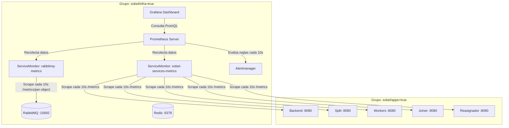

# Hit #4 — Observabilidad (Prometheus, Grafana y Alertas)

Este módulo implementa el stack integral de observabilidad para la arquitectura distribuida del **Hit #3**, utilizando **Prometheus**, **Grafana**, **Alertmanager** y **ServiceMonitors** mediante `kube-prometheus-stack` (Helm).

---

## 1. Arquitectura y Segmentación de Recursos

Siguiendo las decisiones del proyecto, todo el stack de observabilidad corre en el grupo de nodos de infraestructura (**`sobel/infra=true`**) mediante `nodeSelector` y `tolerations` configurados en [`values.yaml`](values.yaml):



* **Aislamiento de Carga:** El scraping y procesamiento de métricas no consume memoria ni ciclos de CPU en los nodos donde se realiza el procesamiento intensivo de imágenes (`sobel/apps=true`).
* **En k3s local:** Para que un único nodo corra ambos grupos sin quedar en `Pending`, se aplican ambas etiquetas:
  ```bash
  kubectl label nodes $(kubectl get nodes -o jsonpath='{.items[0].metadata.name}') sobel/infra=true sobel/apps=true --overwrite
  ```

---

## 2. Métricas Clave y Consultas PromQL

### 2.1 Métricas del Broker de Mensajería (RabbitMQ)
Recolectadas a través del plugin oficial `rabbitmq_prometheus` (puerto `15692`):
* **Mensajes en Cola:**
  ```promql
  rabbitmq_queue_messages{queue=~"sobel.*"}
  ```
* **Throughput de Publicación vs. Consumo:**
  ```promql
  sum(rate(rabbitmq_queue_messages_published_total[1m])) by (queue)
  sum(rate(rabbitmq_queue_messages_delivered_total[1m])) by (queue)
  ```
* **Cola de Mensajes Muertos (DLQ):**
  ```promql
  rabbitmq_queue_messages{queue="sobel.dlq"}
  rabbitmq_queue_messages{queue="sobel.dlq.agotados"}
  ```

### 2.2 Métricas de Negocio (Microservicios en `/metrics`)
Expuestas en el puerto `8080` de cada microservicio según el contrato del Hit #3:
* **Tareas Procesadas por Operación y Resultado:**
  ```promql
  sum(rate(sobel_tareas_procesadas_total[1m])) by (servicio, operacion, resultado)
  ```
* **Latencia de Procesamiento por Tarea (p50 / p95 / p99):**
  ```promql
  histogram_quantile(0.95, sum(rate(sobel_tiempo_tarea_segundos_bucket[5m])) by (le, operacion))
  ```
* **Duración Total de Jobs:**
  ```promql
  histogram_quantile(0.95, sum(rate(sobel_tiempo_job_segundos_bucket[5m])) by (le))
  ```
* **Tasa de Errores de la API (%):**
  ```promql
  (sum(rate(sobel_pedidos_total{codigo=~"5.."}[5m])) / (sum(rate(sobel_pedidos_total[5m])) > 0) * 100)
  ```

### 2.3 Métricas de Infraestructura (Kubernetes)
* **Consumo de CPU por Pod:**
  ```promql
  sum(rate(container_cpu_usage_seconds_total{namespace="sobel", container!=""}[5m])) by (pod)
  ```
* **Consumo de Memoria por Pod:**
  ```promql
  sum(container_memory_working_set_bytes{namespace="sobel", container!=""}) by (pod)
  ```

---

## 3. Reglas de Alerta (`alertrules.yaml`)

Se configuran mediante el Custom Resource `PrometheusRule`:

1. **`SobelColaSaturada` (Warning):**
   * *Condición:* `rabbitmq_queue_messages{queue=~"sobel\\..*"} > 50` durante más de 1 minuto.
   * *Acción esperada:* Escalar réplicas de workers o investigar cuellos de botella.
2. **`SobelWorkerCaido` (Critical):**
   * *Condición:* `kube_deployment_status_replicas_available{namespace="sobel", deployment=~".*worker"} < 1` durante más de 30 segundos.
   * *Acción esperada:* Alertar sobre falla fatal en pods de workers.
3. **`SobelDLQAgotadosPresentes` (Warning):**
   * *Condición:* `rabbitmq_queue_messages{queue="sobel.dlq.agotados"} > 0`.
   * *Acción esperada:* Avisar a los administradores para que revisen los payloads y ejecuten `POST /admin/dlq/reprocesar`.
4. **`SobelTasaErroresElevada` (Critical):**
   * *Condición:* Errores HTTP 5xx superan el 5% del tráfico en 5 minutos.

---

## 4. Instrucciones de Despliegue

### Paso 1: Ejecutar el Script de Instalación Automatizada
```bash
cd hit4
./instalar_observabilidad.sh
```

El script se encarga de:
1. Agregar y actualizar el repositorio de Helm `prometheus-community`.
2. Desplegar `kube-prometheus-stack` en el namespace `monitoring` aplicando [`values.yaml`](values.yaml).
3. Aplicar [`servicemonitor-rabbitmq.yaml`](servicemonitor-rabbitmq.yaml), [`servicemonitor-sobel.yaml`](servicemonitor-sobel.yaml) y [`alertrules.yaml`](alertrules.yaml) en el namespace `sobel`.
4. Registrar el Dashboard de Grafana en el clúster vía ConfigMap con etiqueta `grafana_dashboard: "1"`.

---

## 5. Acceso a las Interfaces de Monitoreo

### Grafana
```bash
kubectl port-forward svc/prometheus-grafana 3000:80 -n monitoring
```
* **URL:** [http://localhost:3000](http://localhost:3000)
* **Usuario:** `admin`
* **Contraseña:** `admin` (configurada en `values.yaml`)
* **Dashboard provisto:** *Sobel Distribuido — Observabilidad y Métricas (Hit #4)* disponible en la sección de Dashboards.

### Prometheus & Alertmanager
* **Prometheus Expression Browser & Alertas:**
  ```bash
  kubectl port-forward svc/prometheus-kube-prometheus-prometheus 9090:9090 -n monitoring
  ```
  Abrir [http://localhost:9090/alerts](http://localhost:9090/alerts) para inspeccionar las alertas activas.

---

## 6. Procedimiento para Disparar una Alerta a Propósito (Evidencia)

Para cumplir con el requisito del enunciado (*"Dashboard con datos reales de un job y una alerta disparada a propósito"*), siga estos pasos:

### Opción A — Provocar alerta `SobelWorkerCaido`:
1. Escalar intencionalmente a 0 las réplicas del worker de Sobel:
   ```bash
   kubectl scale deployment sobel-worker --replicas=0 -n sobel
   ```
2. Esperar 30 segundos.
3. Ingresar a [http://localhost:9090/alerts](http://localhost:9090/alerts) en Prometheus o en el panel de Alertas de Grafana:
   * La alerta **`SobelWorkerCaido`** pasará a estado **FIRING** (color rojo).
4. Restaurar el servicio:
   ```bash
   kubectl scale deployment sobel-worker --replicas=2 -n sobel
   ```

### Opción B — Provocar alerta `SobelColaSaturada`:
1. Pausar temporalmente el consumo de los workers:
   ```bash
   kubectl scale deployment sobel-worker --replicas=0 -n sobel
   ```
2. Enviar un lote de 60 fragmentos mediante el backend o script de carga (`hit3/carga/`).
3. Verificar que la cola `sobel.tareas.*` supere los 50 mensajes:
   * Pasado 1 minuto, la alerta **`SobelColaSaturada`** cambiará a estado **FIRING**.
4. Restaurar las réplicas del worker para vaciar la cola.
