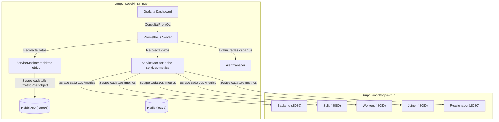

# Hit #4 — Observabilidad (Prometheus, Grafana y Alertas)

Este módulo implementa el stack integral de observabilidad para la arquitectura distribuida del **Hit #3**, utilizando **Prometheus**, **Grafana**, **Alertmanager** y **ServiceMonitors** mediante `kube-prometheus-stack` (Helm).

---

## 1. Arquitectura y Segmentación de Recursos

Siguiendo las decisiones del proyecto, todo el stack de observabilidad corre en el grupo de nodos de infraestructura (**`sobel/infra=true`**) mediante `nodeSelector` y `tolerations` configurados en [`values.yaml`](values.yaml):



* **Aislamiento de Carga:** El scraping y procesamiento de métricas no consume memoria ni ciclos de CPU en los nodos donde se realiza el procesamiento intensivo de imágenes (`sobel/apps=true`).
* **En k3s local:** Para que un único nodo corra ambos grupos sin quedar en `Pending`, se aplican ambas etiquetas simultáneamente:
  ```bash
  kubectl label nodes $(kubectl get nodes -o jsonpath='{.items[0].metadata.name}') sobel/infra=true sobel/apps=true --overwrite
  ```

---

## 2. Métricas Clave y Consultas PromQL

### 2.1 Métricas del Broker de Mensajería (RabbitMQ)
Recolectadas a través del plugin oficial `rabbitmq_prometheus` (puerto `15692`):
* **Mensajes en Cola:**
  ```promql
  rabbitmq_queue_messages{queue=~"sobel.*"} or max(sobel_tareas_en_cola) by (cola)
  ```
* **Throughput de Publicación vs. Consumo:**
  ```promql
  sum(rate(rabbitmq_queue_messages_published_total[1m])) by (queue)
  sum(rate(rabbitmq_queue_messages_delivered_total[1m])) by (queue)
  ```
* **Cola de Mensajes Muertos (DLQ):**
  ```promql
  rabbitmq_queue_messages{queue="sobel.dlq.agotados"}
  ```

### 2.2 Métricas de Tareas y Errores de Microservicios
* **Throughput de Tareas Procesadas:**
  ```promql
  sum(rate(sobel_tareas_procesadas_total[1m])) by (servicio, operacion, resultado)
  ```
* **Tasa de Errores por Servicio y Tipo:**
  ```promql
  sum(rate(sobel_errores_total[1m])) by (servicio, tipo)
  ```

### 2.3 Métricas de Latencias y Cumplimiento de SLOs
* **Latencia de Tarea por Operación (p50, p95, p99):**
  ```promql
  histogram_quantile(0.95, sum(rate(sobel_tiempo_tarea_segundos_bucket[5m])) by (le, operacion))
  ```
* **Tiempo Total de Job (SLO 2: p95 <= 30s para <=10MB):**
  ```promql
  histogram_quantile(0.95, sum(rate(sobel_tiempo_job_segundos_bucket[5m])) by (le))
  ```
* **Tasa de Errores HTTP 5xx (SLO 3: < 1%):**
  ```promql
  sum(rate(sobel_pedidos_total{codigo=~"5.."}[5m])) / sum(rate(sobel_pedidos_total[5m])) * 100
  ```

### 2.4 Consumo de Recursos en Kubernetes (Pods y Nodos)
* **CPU Utilizada por Pod:**
  ```promql
  sum(rate(container_cpu_usage_seconds_total{namespace="sobel", container!=""}[5m])) by (pod)
  ```
* **Memoria Utilizada por Pod:**
  ```promql
  sum(container_memory_working_set_bytes{namespace="sobel", container!=""}) by (pod)
  ```
* **CPU Utilizada por Nodo (%):**
  ```promql
  100 - (avg by (instance) (rate(node_cpu_seconds_total{mode="idle"}[1m])) * 100)
  ```
* **Memoria Utilizada por Nodo (%):**
  ```promql
  100 * (1 - (node_memory_MemAvailable_bytes / node_memory_MemTotal_bytes))
  ```

---

## 3. Catálogo de Alertas Automáticas (`alertrules.yaml`)

Definidas como un recurso `PrometheusRule`:

1. **`SobelColaSaturada` (Warning):**  
   Se activa si `sobel.tareas.*` o cualquier cola acumula más de **50 mensajes** durante más de 1 minuto.
2. **`SobelWorkerCaido` (Critical):**  
   Se activa si el worker (`sobel-worker`) tiene 0 réplicas disponibles o falla su probe durante más de 30 segundos.
3. **`SobelDLQAgotadosPresentes` (Warning):**  
   Se activa si hay mensajes en `sobel.dlq.agotados` requiriendo reprocesamiento manual.
4. **`SobelTasaErroresElevada` (Critical):**  
   Se activa si la tasa de errores `5xx` supera el **5%** en un intervalo de 2 minutos.

---

## 4. Despliegue del Stack de Observabilidad

Ejecutar el script automatizado:
```bash
./hit4/instalar_observabilidad.sh
```

El script se encarga de:
1. Agregar y actualizar el repositorio de Helm `prometheus-community`.
2. Generar el Secret `grafana-admin-credentials` de forma dinámica (sin contraseñas fijas).
3. Desplegar `kube-prometheus-stack` en el namespace `monitoring` aplicando [`values.yaml`](values.yaml).
4. Aplicar [`servicemonitor-rabbitmq.yaml`](servicemonitor-rabbitmq.yaml), [`servicemonitor-sobel.yaml`](servicemonitor-sobel.yaml) y [`alertrules.yaml`](alertrules.yaml) en el namespace `sobel`.
5. Registrar el Dashboard de Grafana en el clúster vía ConfigMap con etiqueta `grafana_dashboard: "1"`.

---

## 5. Acceso a las Interfaces de Monitoreo

### Grafana
```bash
kubectl port-forward svc/prometheus-grafana 3000:80 -n monitoring
```
* **URL:** [http://localhost:3000](http://localhost:3000)
* **Usuario:** `admin`
* **Contraseña:** Generada dinámicamente en el despliegue (almacenada en `grafana-admin-credentials` y en `.env.secrets`).
* **Dashboard:** *Sobel Distribuido — Observabilidad y Métricas (Hit #4)* (14 paneles).

### Prometheus & Alertmanager
```bash
kubectl port-forward svc/prometheus-kube-prometheus-prometheus 9090:9090 -n monitoring
```
* **URL:** [http://localhost:9090/alerts](http://localhost:9090/alerts) para inspeccionar las alertas activas.

---

## 6. Procedimiento para Disparar una Alerta a Propósito (Evidencia)

Para cumplir con el requisito del enunciado (*"Dashboard con datos reales de un job y una alerta disparada a propósito"*), siga estos pasos:

### Opción A — Provocar alerta `SobelWorkerCaido`:
1. Escalar intencionalmente a 0 las réplicas del worker de Sobel:
   ```bash
   kubectl scale deployment sobel-worker --replicas=0 -n sobel
   ```
2. Esperar 30 segundos.
3. Ingresar a [http://localhost:9090/alerts](http://localhost:9090/alerts) en Prometheus o en el panel de Alertas de Grafana:
   * La alerta **`SobelWorkerCaido`** pasará a estado **FIRING** (color rojo).
4. Restaurar el servicio:
   ```bash
   kubectl scale deployment sobel-worker --replicas=2 -n sobel
   ```

### Opción B — Provocar alerta `SobelColaSaturada`:
1. Pausar temporalmente el consumo de los workers:
   ```bash
   kubectl scale deployment sobel-worker --replicas=0 -n sobel
   ```
2. Enviar un lote de peticiones con el runner de carga (`hit3/carga/`):
   ```bash
   ./hit3/carga/correr_matriz.sh --celda 50 1 10 1mb
   ```
3. Verificar que la cola `sobel.tareas.*` supere los 50 mensajes:
   * Pasado 1 minuto, la alerta **`SobelColaSaturada`** cambiará a estado **FIRING**.
4. Restaurar las réplicas del worker para vaciar la cola.
